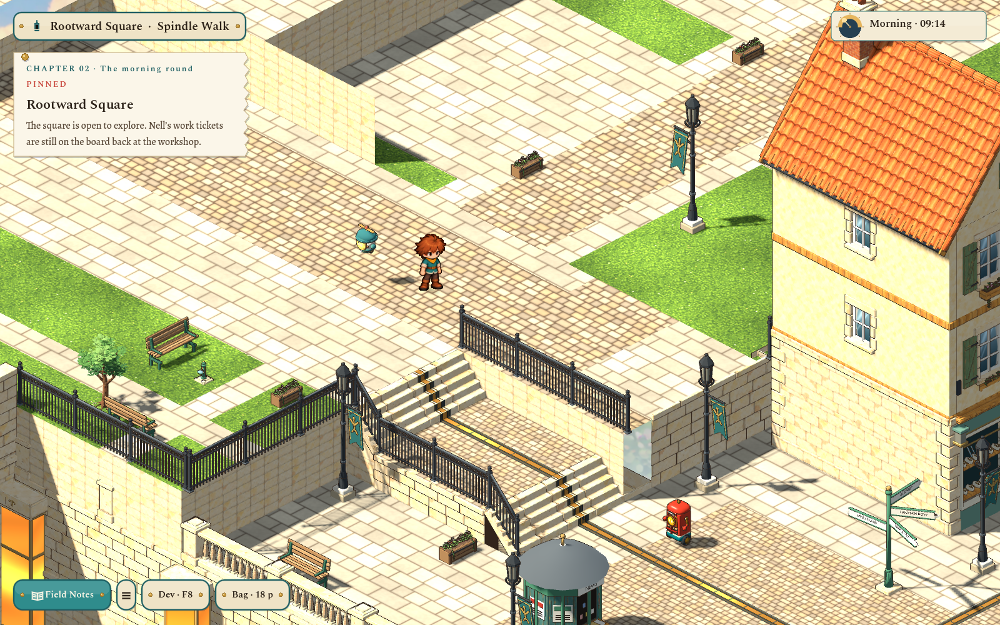

# Spindle Walk: wider arrival, park, future frontages and original concepts

The user's marked follow-up rejected the two reused shop-house shells and the blank back lawn. This pass implements the strip and loading-boundary groundwork, removes the temporary twins, clears the five interiors, and supplies original imagegen concepts. Replacement building models and interior assets remain deferred for a later pass.

## Playable changes

- The high arrival court extends westward and farther north of the east-descending stairs. The five-cell `uphill` transition moves from y6–10 to **y10–14**, centered on `(0,12)`. Spindle Lane's own gate stays in place; its target arrivals move to `(1,11)` and `(1,13)`, default `(1,12)`.
- A small **Spindle Garden** occupies the raised area left of the stairs, with simple paths, two benches, a small tree, a planted box, bird bath and real edge railings.
- **Spindle Walk** continues north past four paved shop frontages. The first two are reserved in the design document for the clockmaker and apothecary, with two further frontages available. They face east into the central promenade and toward the square. They are open unbuilt courts, with no invisible building collision or invented shop interactions.
- Native review revealed that a route close to the market would hide the player behind its roofs. The frontage courts and promenade were shifted west; the approved camera and player artwork remain intact. The walk has benches, narrow trees, planters, real street lights and a continuous railing above the drop.
- The temporary clockmaker/apothecary reskins and their exterior links are unplaced. Their sources and saved rooms remain. Continue already inside either room can still exit onto a safe strip cell.
- All five shop interiors are cleared of stock, counters, furniture and stock inspections. Only the reusable shell, doorway and structural light fittings remain. The three market buildings still enter their empty rooms; old room memory/programs are retained. New interior assets will be authored later.

[Park at gameplay scale](../../evidence/spindle-strip/game/park-in-game.png) · [Promenade and frontage courts](../../evidence/spindle-strip/game/promenade-in-game.png) · [Northern frontages](../../evidence/spindle-strip/game/future-frontages.png) · [Empty bakery shell](../../evidence/spindle-strip/game/bakery-empty.png).

## Building concepts for review

Generated with the **built-in image_gen tool**, one generation per building, copied into the project unchanged. Both sheets include a main front view and a smaller rear view. These are proposed references; neither image is a runtime asset or an approved final model.

- [Pendulum & Pin](../../art/source/world/spindle-strip/v1/clockmaker-concept.png): offset clock turret, tall glazed pendulum bay, recessed entrance and native clock display frontage. Copper, limestone and oak give it a dedicated clockmaker silhouette.
- [Thyme & Tonic](../../art/source/world/spindle-strip/v1/apothecary-concept.png): a lower asymmetrical stone shop, curved glazed frontage, herb glasshouse and a service side. It is a separate building design, not a color variant of the clockmaker or the old houses.

[Concept gallery](../../docs/concept/v0.8/spindle-strip.md) · [Exact final prompt set](../../art/source/world/spindle-strip/v1/concept-prompts.json) · [Image hashes/provenance](../../art/source/world/spindle-strip/v1/concept-provenance.json).

## Source and saved-world boundaries

`content/areas/haverlund-square.json` v6, `haverlund-lane.json`, and `content/development/spindle-strip-plan.json` own layout and links. Ground v3 copies the adopted v2 master before bounded edits; v2 and area v5 remain preserved. The edit does not regenerate the rest of the town. Existing packed ground paintings and local sections remain, and the new faces are sectioned for local lighting/culling. Normal `scripts/world-art.sh build haverlund-square-ground` audited 1,246 mesh sections and 165,971 triangles before promotion.

The foot-circle and passage rules check park/edge barriers as before. Recovery now also accounts for new square furniture envelopes, so an old position covered by the park tree relocates only the feet. Shop IDs, lamp state and independent program memory survive the clearing. The fixed real-light system remains: **67 logical square fittings**, with no camera-selected light pool. The full-square light test reports zero meshes exceeding eight affecting point lights.

## Validation

- Square graph and real lane travel: 234 checks passed.
- Strip/cleared-room/save-recovery rules: 41 checks passed.
- Native Godot 4.7.2 at 1600×1000: **57 checks passed**, including moved loading boundary both ways, both stair flights, park and long promenade, three working market doors, all five empty interiors, old retired-room exits, and Continue retaining room memory.
- The complete `scripts/test.sh` run passed gameplay, UI, art, 969 world-view checks and source guards. It reached the handoff check while this new review link was still being written and stopped there. After the review existed, `test/test_pipeline_handoff.py` and the remaining `test/test_ground_art.py` were rerun successfully. All suite checks now pass.
- `git diff --check`: passed.

[Source/edit record](../../art/source/world/spindle-strip/v1/README.md). The revised ground is delivered through the Finished queue after validation; original building modeling and interior furnishing remain later work at the user's request.
