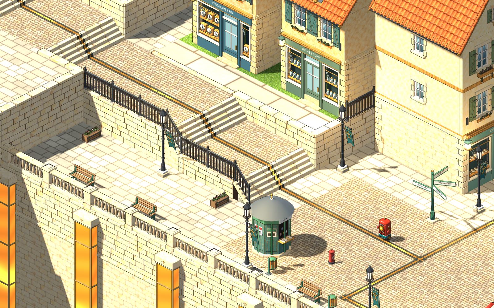
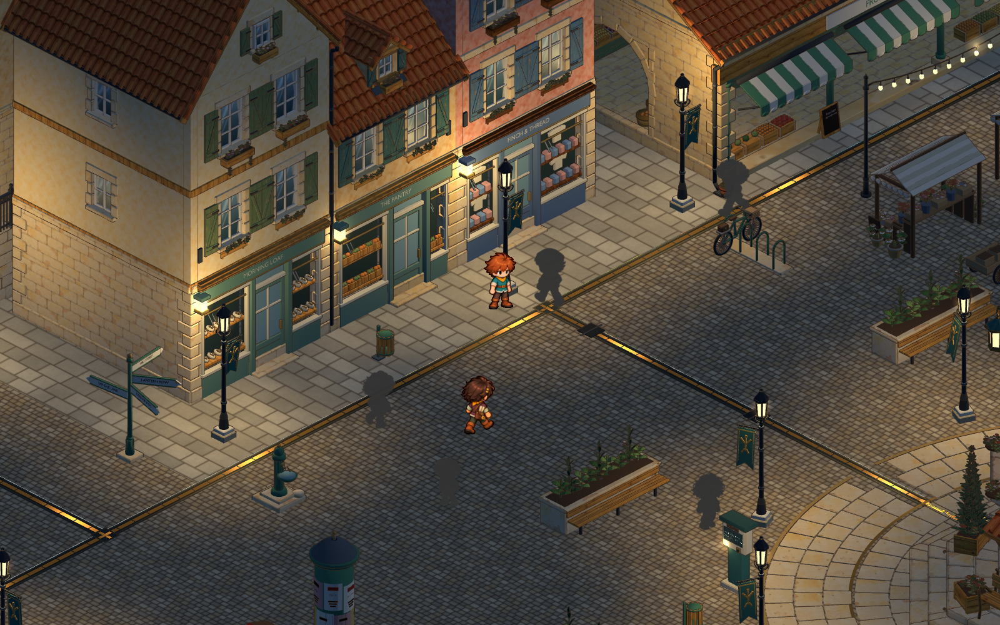

# Square lighting, reusable barriers and shopping strip — 2026-11-03

Implemented the user's annotated square revision, including their final choice of **clockmaker + apothecary**. The approved player artwork and camera are retained. Existing uncommitted work and earlier adopted source versions are preserved; no commit or external publication was made.

## Lighting

Two separate problems caused weak, camera-dependent illumination. Ordinary lamps borrowed six real lights that were reassigned by distance to the camera focus. Mapped fixtures already had their own lights but also entered that pool, creating duplicates. In addition, large whole-town ground surfaces and the Rootwell/plaza overlapped more than the Compatibility renderer's eight point lights per mesh. Godot explicitly documents flicker/pop-in when this limit is exceeded: [OmniLight3D reference](https://docs.godotengine.org/en/4.7/classes/class_omnilight3d.html).

Every ordinary lamp now owns a fixed light; mapped fittings retain their own source without a second pool light. Camera movement never relocates or disables these sources. The square's main lamps have 7 m range and 1.65 energy. The small path-light models and all sixteen corresponding logical fittings are removed. Thirty-eight largely hidden houses are removed from square placements, leaving eighteen simpler background houses, a few lower-town trees and a quiet upper park. Model sources and other areas' placements remain available.

The square now has **66 logical fittings (115 before)** and **69 total point lights in the review scene (124 before)**. Committed on/off state, daylight relays, preview/clear and supply trips still use the shared rules. The Rootwell's intrinsic chamber artwork remains luminous during a supply trip; street illumination, lantern glass, halos and conduit power respond to the breaker. Most point lights remain shadowless to contain cost; the existing directional shadow system remains. Trading and the future power-surge/challenge content are not added by this pass.

Existing ground faces are cut into local 4 m sections near the square and 16 m sections farther out. Large static Rootwell/plaza surfaces use 3 m sections, with their UVs, corner normals, moving-part hierarchy and power metadata preserved. The final audit found **zero mesh sections exceeding eight affecting point lights** across the full square at the reviewed state. The new regression test also checks that moving the camera leaves light positions and visibility unchanged.

## Shops and layout

- Market frontage: **Morning Loaf** bakery, **The Pantry** food shop, and **Finch & Thread** clothier. Their preserved building IDs remain `bakery`, `greengrocer` and `bookshop`.
- Above Spindle Steps: **Pendulum & Pin** clockmaker and **Thyme & Tonic** apothecary, with a reachable pavement on the high terrace. The upper lawn behind them has sparse trees, two benches and a small fountain as background dressing.
- All five have recessed wares, painted joinery, glazed hinged doors and separate saved interiors. The rooms share a reusable cutaway shell and use distinct existing stock/work furniture; the clockmaker gets an additional native clock display. Frontage overlap checks pass after removing the old fascia behind the new joinery.
- Reciprocal ordinary walking input enters/exits every room. Continue retains each room's independent memory. No shop trading, clock-setting or apothecary programming quest is implemented yet.

[All five interior captures](../../evidence/square-renewal/shops/) include the [clockmaker](../../evidence/square-renewal/shops/clockmaker-interior.png) and [apothecary](../../evidence/square-renewal/shops/apothecary-interior.png). [Upper park](../../evidence/square-renewal/upper-park.png). Native reviews used Godot 4.7.2 at 1600×1000 with the gameplay camera.

## Reusable barriers

The town railings, garden walls, balustrades and their joints already existed as separate authored models. They now have reusable catalog collision envelopes, explicit `solid` placements in the square, and studio build-shelf entries. `AreaDef` transforms those envelopes independently of the renderer and `LabWorld` checks them with the existing foot-circle/passage rules. The hall's two garden entrances remain open; crossing their visible walls is blocked. Builder props correctly respect a bay's offset start pivot after rotation. Saves covered by repaired barriers retain their progress and relocate only the player's feet.

A new 3 m limestone retaining-wall module replaces one straight bay beside the upper terrace. Special terrain walls, copings and stair cheeks remain in the spatially sectioned ground master; this pass does not claim that every retaining surface has become a loose piece. Immutable repeated barrier visuals share local 8 m MultiMeshes while placement identities and collision remain separate. The Sparks route still has its existing build-mode policy; the new shelf pieces are studio tools.

## Measured performance

Same integrated AMD Radeon 680M, Compatibility renderer, 1600×1000, VSync disabled, 30 warm-up frames and 120 measured frames per fixed view. Each row is one representative run; NPC timing and system load vary. The final capture improved three views; the Rootwell median rose by 0.383 ms and remains the main draw-call hotspot. Earlier runs were faster, so system load and run-to-run variance also matter. These are representative samples, not a promise for every machine or future district.

| View | Median before → after | 95th percentile before → after |
| --- | --- | --- |
| Spindle Steps | 8.765 → 6.468 ms | 12.571 → 9.828 ms |
| Market shops | 9.389 → 7.582 ms | 20.088 → 15.758 ms |
| City Hall | 10.886 → 9.201 ms | 12.695 → 11.728 ms |
| Rootwell | 8.691 → 9.074 ms | 11.324 → 12.500 ms |

Synchronous scene construction fell from **8.989 s to 6.904 s**. Total nodes changed from 6,114 to 6,004; point lights from 124 to 69. Caching the world catalog avoids parsing it for every placed model. Local culling reduces the visible geometry cost, and flat ground tops skip redundant silhouette hulls. Draw calls increased (for example, Rootwell 597 → 1,066) because local mesh sections are necessary for correct lighting; this remains a scaling concern despite improvements elsewhere and all sampled 95th-percentile times remaining below the 16.67 ms budget for 60 fps. Raw records: [before](../../evidence/square-renewal/before/metrics.json), [after](../../evidence/square-renewal/after/metrics.json).

Next optimization priorities are distant roof/foliage LOD, continued batching of genuinely repeated immutable geometry, and district/room streaming as the town grows. Keep light-overlap and frame-time checks alongside those changes. Increasing a global light limit or baking switchable street light into textures would hide the underlying budget problem or weaken future power changes.

## Validation and delivery

- Normal `scripts/world-art.sh build` plus GLB audits for all eleven changed/new masters.
- Square traversal: 231 checks; renewal collision/save recovery: 39 checks.
- Full-square light budget/fixed-source/preview/supply regression: zero failures.
- Runtime fixture audit across all ten Sparks areas: 446 checks.
- Real Game walk-in/walk-out and Continue review: 61 checks.
- Coplanar surface regression: 11 checks; Rootwell moving-part/material contract: 35 checks.
- Full `scripts/test.sh`: **passed**, including 969 world-art/view checks, 1,573 handoff checks, the existing WASI/app/UI/build flows, source guards and ground-art tests. `git diff --check` also passed.

The seven relevant requests are delivered through the development menu’s Finished queue after validation. Acceptance remains with the user. [Source/edit records](../../art/source/world/square-renewal/v1/README.md).
