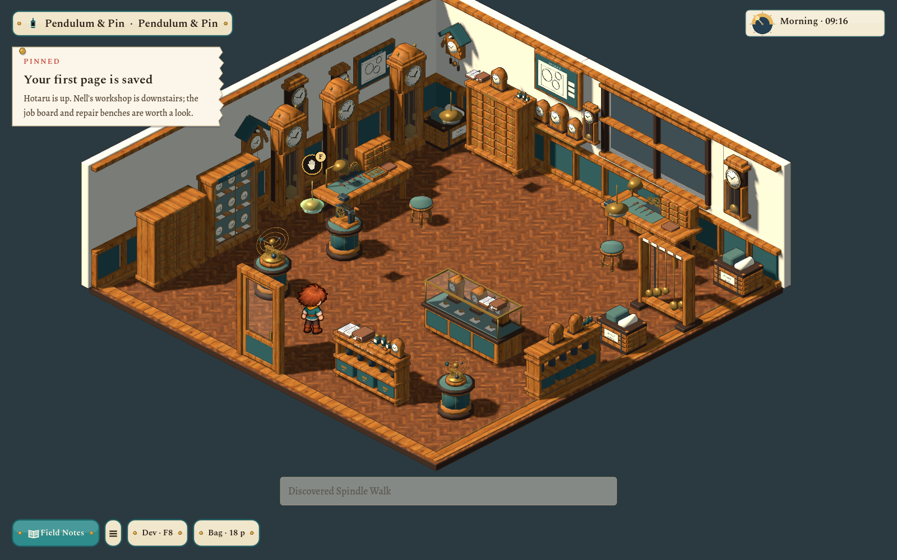

# Deeper gradual mist and a fuller clockshop

The user asked for the square's dark/fog boundary to sit roughly twice as far below the wall rim, with a gradual fade, and for the clockshop to be slightly larger and much more fully dressed for a future quest.

## Gradual depth

The old flat surfaces at about -3 m are replaced by one alpha-only depth overlay. It reconstructs actual world height, leaves the rim unchanged, starts fading around -2.8 m and becomes opaque at -7 m. Night fades into near-black; daylight fades into softly drifting mist. Because it adds fog alpha over the rendered scene rather than copying the opaque scene color, it preserves transparent glass and characters. The depth reconstruction follows [Godot 4.7's documented Compatibility/Forward+ coordinate conventions](https://docs.godotengine.org/en/4.7/tutorials/shaders/advanced_postprocessing.html).

[Night at the wall](../../evidence/clockshop-expansion/08-mist-night.png) · [Day mist](../../evidence/clockshop-expansion/07-mist-day.png).

Ground v6 deliberately extends the retained v5 master with vertical masonry previously removed below the old cutoff. It adds no houses, parks or lower streets. Its audited output is **1,128 mesh sections / 156,549 triangles**, compared with v5's 1,119 / 145,991. Showing deeper masonry costs additional geometry; it remains below the pre-flat v3's 165,971 triangles. The atmospheric pass is two triangles and one draw, replacing three surface quads. This is a geometry comparison, not a whole-game frame-rate claim. The square still has 68 fixed lamp bindings and zero meshes exceeding eight affecting local lights.

The shader skips cloud/ray work for geometry above the fog. Two paired 90-frame samples on the AMD Radeon 680M at 1600×1000, uncapped with VSync off, measured frame medians of 4.129/4.478 ms with the pass hidden and 4.738/4.947 ms with it visible. The paired increase was about 0.47–0.61 ms in this fixed view; these are whole-frame samples rather than isolated GPU timings.

The GPU fixture checks actual rendered pixels at heights -1, -3.5, -5, -6.5 and -8 m. Night luminance fell progressively through **1.000, 0.885, 0.401, 0.012 and 0.0003**; daytime remained mist-colored at the bottom. [Gradient proof](../../evidence/clockshop-expansion/gradient-night.png).

## Expanded clockshop

The room grows from **12×12 to 14×14**, with 50 placed objects and fourteen distinct inspections. Thirteen new reusable model types join the earlier nine: planetary orrery, curio plinth, pocket-watch cabinet, spring winder, pendulum rack, drawing board, service cabinet, oils/cleaning tools, open ledgers, clock delivery crates, padded stool, wall shelf and carved cuckoo clock. Every model has its own adopted Blender source, audited runtime export and studio catalog entry. None imports a generic furniture model. [Sources and authoring record](../../art/source/world/clockshop-interior/v2/README.md).

The collection is arranged as an intake counter, sales displays, two repair benches, spare-parts storage, pendulum regulation and packed deliveries. Models are reused through independent placements. The enlarged shell preserves the functional doorway and the parquet scale/clearance. Three real pendant lights follow town power. The exterior clockmaker and the restored terraces remain as selected in the previous review.

[Orrery inspection](../../evidence/clockshop-expansion/10-orrery-inspection.png) · [Repair corner at gameplay scale](../../evidence/clockshop-expansion/11-repair-corner.png).

The central 3×3 workspace and all inspection approaches remain connected and walkable. The native review physically walks to every inspection and uses F to read it; Continue retains those readings and program memory, and the shop door still returns to the correct facade. Existing three inspection IDs remain valid. Room/source v1–v3 history is preserved. Stock mechanisms are decorative; this pass reserves quest space without adding a quest or trading system.

## Validation

- Normal world-art exports/audits for the ground, enlarged shell and all thirteen new model types; editor import completed.
- Clockshop model/layout/collision/inspection/save checks: **102 passed**.
- Native Godot 4.7.2 / Compatibility at 1600×1000: **63 checks passed**, including all fourteen F inspections, Continue, real entry/return, shared exterior clock and day/night exterior captures.
- Native GPU depth/gradient fixture: **6 checks passed**; no shader compile errors.
- Fixed-lamp/light-overlap regression: 68 fittings, zero over-budget meshes, zero failures.
- Full `scripts/test.sh`: **passed, exit 0**, including 1,057 world-art/view checks, 1,663 pipeline/handoff checks, 121 ground-art checks, source/workflow guards and the complete gameplay/UI/WASI suite. The final shader optimization was followed by the GPU gradient test and native performance sample. `git diff --check` passed.

No user draft or earlier Blender master was overwritten, and no commit or external publication was made. All three relevant requests are in Finished with current source/runtime fingerprints; acceptance remains with the user.
