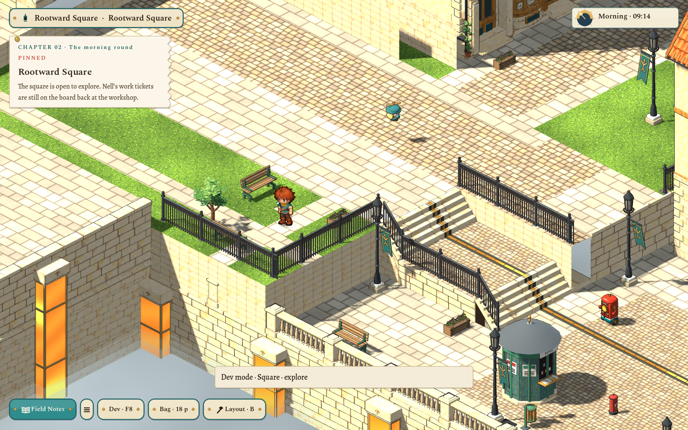
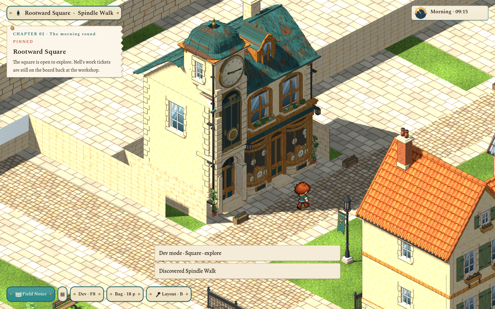
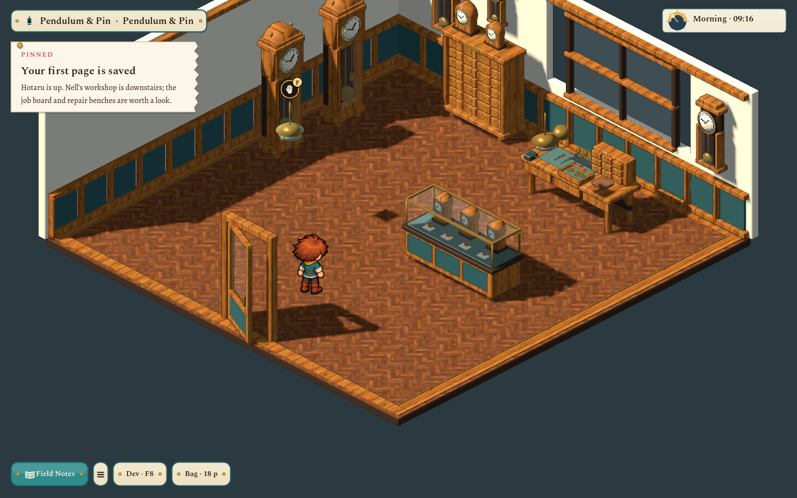

# Restored terraces, depth mist and Pendulum & Pin

The user clarified that restoration means **the layout immediately before the flat expansion**, rather than the first screenshot. Area v8 and ground v5 select that smaller garden, promenade, retaining walls and two stair flights. The large flat rear shelf is removed. The incoming loading boundary remains four cells west, and the saved `[16,0]` coordinate offset remains stable.

## Clockmaker entrance and room

The adopted exterior v3 is preserved; v4 adds a 0.16 m stone plinth and a properly hinged central glazed door **between the two clock displays**. Its oak leaf and clear glazing share one hinge. The recessed residence entrance stays static and does not open with the shop door. The active exterior approach and room return are `(16,21)` westward; ordinary movement opens the door and travels to the separate saved room.

The clockmaker remains at `(12.5,20)`, facing east toward the lane. Only its 6.2×9 m plot is recessed into the higher rear terrain, avoiding ground penetration while keeping the doorway visible from the lane. A trial placement farther east was obscured by the foreground market roof and is not selected. The original terraces outside this bounded plot remain. The first strip lamp and its service stand are kept clear of building collision.

The interior uses nine original `clockshop-*` model types: cutaway shell and door, longcase clock, wall regulator, glazed stock counter, repair bench, parts cabinet, loose clockwork tray, brass pendant and mantel clock. The room reuses these new models through separate placements; all six portable furnishings also have studio shelf entries. No geometry from the rejected interior assets is used. New frames, cabinet drawers, clock rims/hands/weights, open-spoked gears, vise, drivers, lamp and labels are modeled, with separate clear glass and lamp emitters.

The parquet is a new built-in imagegen painting. Its [full-resolution source](../../art/source/world/clockshop-interior/v1/textures/clockshop_parquet.png), [exact prompt](../../art/source/world/clockshop-interior/v1/floor-prompt.txt) and hash provenance are retained. The existing `scripts/art.sh` builds its lush/solid/512 px detail outputs. A continuous unoutlined floor avoids false 3 m panel seams. Shared approved oak paint receives an exporter-supported walnut tint; no old furniture models are reused. [Collection and editable sources](../../art/source/world/clockshop-interior/v1/README.md).

Furniture collision leaves the entrance, inspections and return reachable. Old saves covered by new furniture retain their memory and recover their feet. Facade hands still follow town time; exterior lighting and the new room pendants follow town power. Stock clock hands are decorative. Trading, a clock-setting challenge and shopkeeper living quarters are not implemented.

## Mist and geometry

The lower houses previously removed remain absent; fifteen deep scenery/power-support placements are additionally removed from the restored baseline. Detailed ground faces below the mist are culled. Three unlit surface quads at -3.0, -2.6 and -2.15 m hide the bottom and soften the meeting with masonry. All three layers darken with shared town time. This is surface mist, not volumetric fog.

[Day mist](../../evidence/square-restoration/07-mist-day.png) · [Dark depth at night](../../evidence/square-restoration/08-mist-night.png).

The restored ground audits **1,119 meshes / 145,991 triangles**, compared with the pre-flat v3's 1,246 / 165,971. The atmosphere adds six triangles. This is a source-geometry comparison, not a whole-game frame-rate claim. All 68 fixed lamp bindings remain; the light budget test finds zero lit meshes over eight affecting point lights. Atmospheric geometry uses layer 2 and local fixtures illuminate layer 1.

## Saves and editing

Layout tools remain available through **B / Layout · B**, with fourteen scoped garden/barrier pieces, half-cell paint, existing prop movement, undo/redo and saved layouts. The user's original export is untouched and copied byte-for-byte to `content/areas/archive/haverlund-square-v7-layout-sketch.json`. Both have SHA-256 `3684b96a0b7d853301640e3bf64197e7a6595f9c03e0869eaf59bbd5f9d7ba1f`.

`BuildLedger.saved_edits()` retains retired flat-layout edits in an archive with an epoch rather than replaying them over different ground. New layouts and the archive survive Continue. Program memory, inventory, accounts and room progress remain independent. Feet stranded on removed shelf cells recover at the safe incoming landing. Earlier area documents and adopted Blender masters remain available; no commit or publication was made.

## Validation

- Normal art build and audited world builds for both updated exterior/ground masters and all nine new interior types.
- Clockmaker rules/model/save recovery: 76 checks; layout/archive/paint rules: 29 checks; renewed square traversal and barrier checks; zero light-budget failures.
- Native Godot 4.7.2 / Compatibility at 1600×1000: 20 checks for the restored garden, day/night mist, shared-time hands, visible central hinge, actual walk-in/out, Continue and independent room memory. Separate native layout review: 28 checks for two-way loading, mouse placement, paint/erase/undo/redo, export, Continue and descending both stairs.
- Full `scripts/test.sh`: passed (exit 0), including 1,005 world-art/view checks, 1,621 pipeline/handoff checks, authoring/workflow guards, ground-art tests and all gameplay/UI/WASI flows. The final subfloor-clearance edit was rebuilt/imported and rechecked: 76 clockshop checks, 1,005 world-art checks and 20 native walkthrough checks passed. `git diff --check` passed.

Sources/edit records: [restoration](../../art/source/world/square-restoration/v1/README.md). The three relevant asset requests are now in Finished with current source/runtime fingerprints; acceptance remains with the user.
