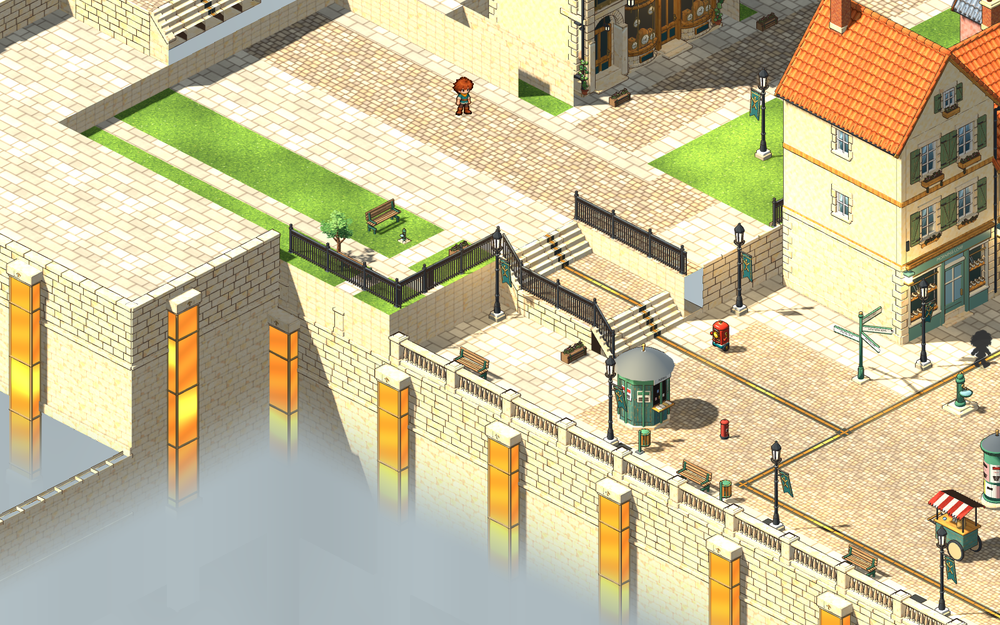
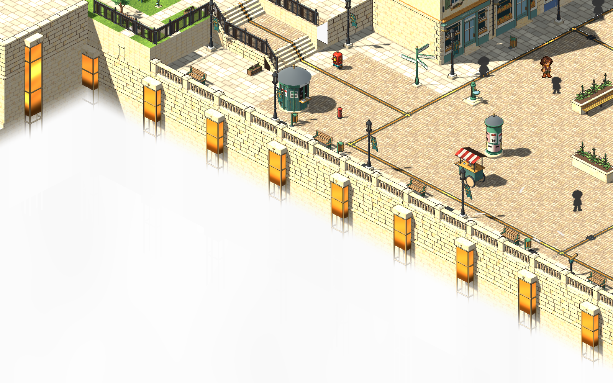
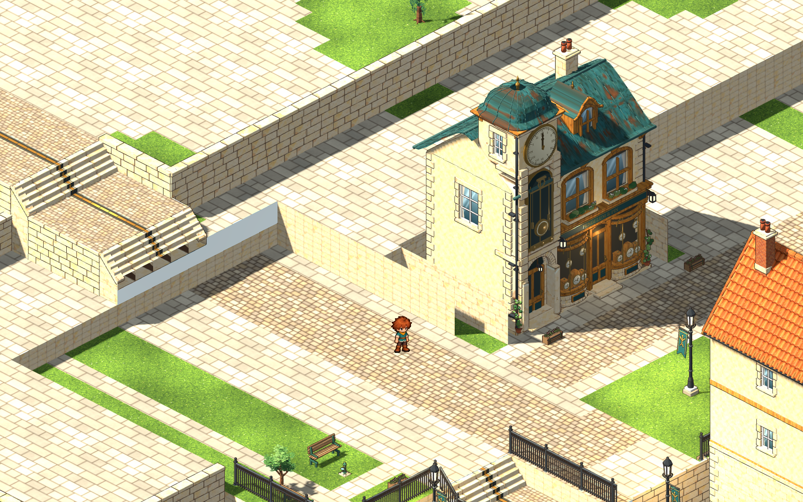
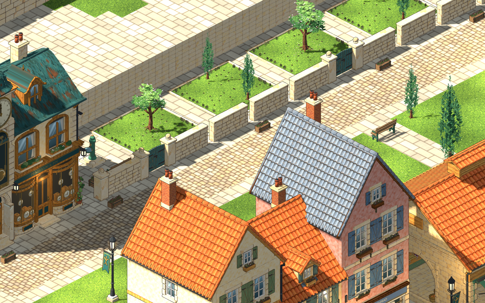
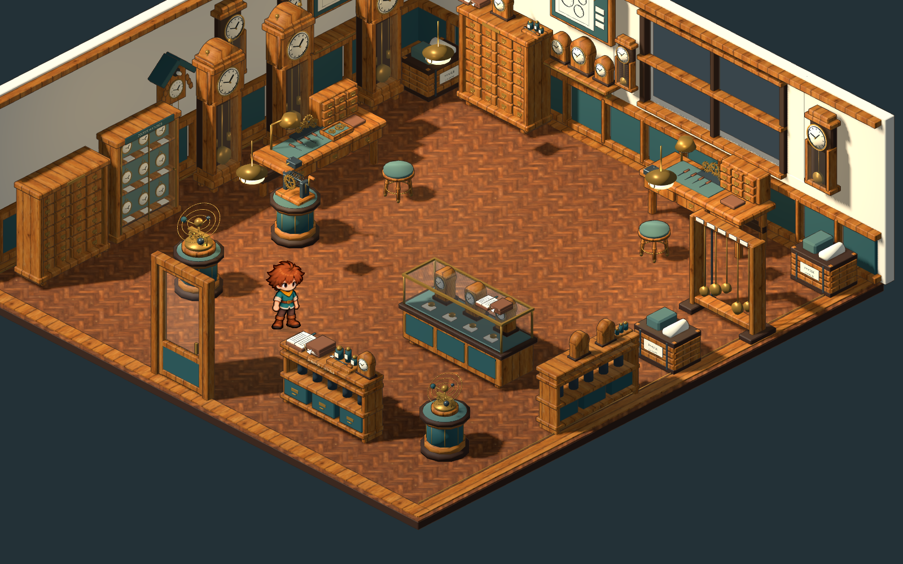
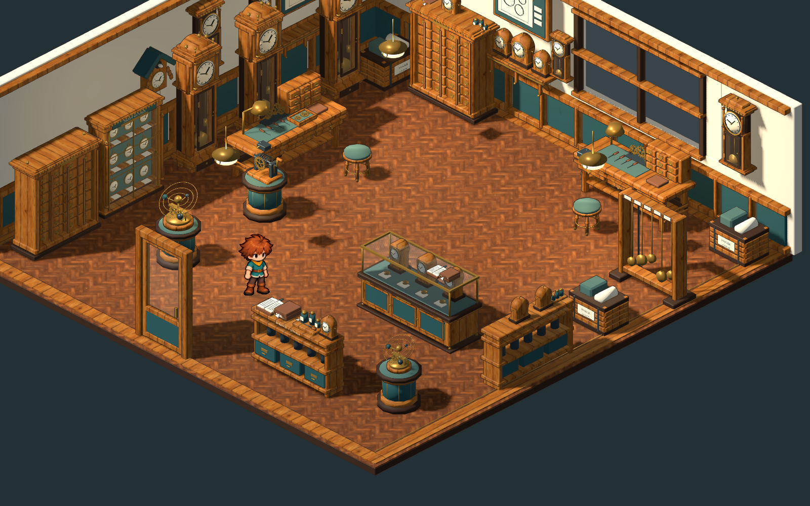

# Purge, faster tests, white mist, the clockmaker's court and clockshop furniture — 2026-11-05

## Purge

Kindle Hollow and Village Morning were removed with their areas, quests, models, lessons, tests, tools and manuals; the full list, what was kept on purpose and how to restore anything are in [docs/PURGE_2026-11-05.md](../../docs/PURGE_2026-11-05.md). 91 world models and their sources went (about 390 MB of masters and GLBs), the builder shelf shrank from 105 to 34 entries, and a plain-data fixture village keeps the build, terrain, ground and door rules under test.

One latent bug surfaced and was fixed: the first room was built before the journey's look was applied, so a new game started with the old ring-and-beam job marker instead of the brass dial. `Game._build_world` now sets the marker style first.

## Tests

`scripts/test.sh` now reads `test/manifest.json` and runs the checks in parallel: `quick` (rules, documents, art contracts, guards) in about 20 s, `flow` adds the real game scene, `full` adds the audit of every runtime model in about a minute (previously about twelve minutes serially), and `smoke` boots the game, loads every room and round-trips a save in about 20 s. A passing test that prints a `SCRIPT ERROR` now fails, which exposed one check in `test_sparks` that had been aborting part of its own run. [test/README.md](../../test/README.md) says which tier suits which change. `scripts/screenshot.sh` is a new tour of the real game.

## Rootward Square

The depth mist is now solid white below the walls (day), with a short soft edge and nothing of the lower town showing through, and the power pillars and conduits stop glowing where the mist begins (`light_floor`); see [AREAS](../AREAS.md#the-high-square-white-mist).

The shelf behind Pendulum & Pin had free-standing pit walls around the shop, random grass patches and nothing guarding anything. Ground v7 lays one flagged court; the document dresses it as a walled garden with gates, lawns, trees and a fountain ([record](../../art/source/world/square-restoration/v2/README.md)). The walkable terrace, links, collision and saved coordinates are unchanged. The strip of white seen beside the stairs west of the shop is a hole in the old ground through which the mist shows; it now reads as the same white and was not rebuilt.

## Clockshop furniture

Eight masters (`longcase`, `regulator`, `mantel-clock`, `display-counter`, `repair-bench`, `parts-cabinet`, `wall-shelf`, `watch-cabinet`) gained mouldings and cornices with dentils, turned columns, framed glazed doors with hinges and escutcheons, panel frames, finials, handles, brass feet, a lower shelf and a tool box. New `v2/model.blend` files beside the retained v1, built through `scripts/world-art.sh build`; record `art/source/world/clockshop-interior/v3/refine_curios.py`. Placements and collision are unchanged. The clockshop requests in Finished now carry stale fingerprints and need the user's re-review.

## Checks

`scripts/test.sh full`: 46 of 46 passed in about a minute. Reviewed at the real camera with `tools/area_shot.gd` and the Sparks tour. Not committed.
