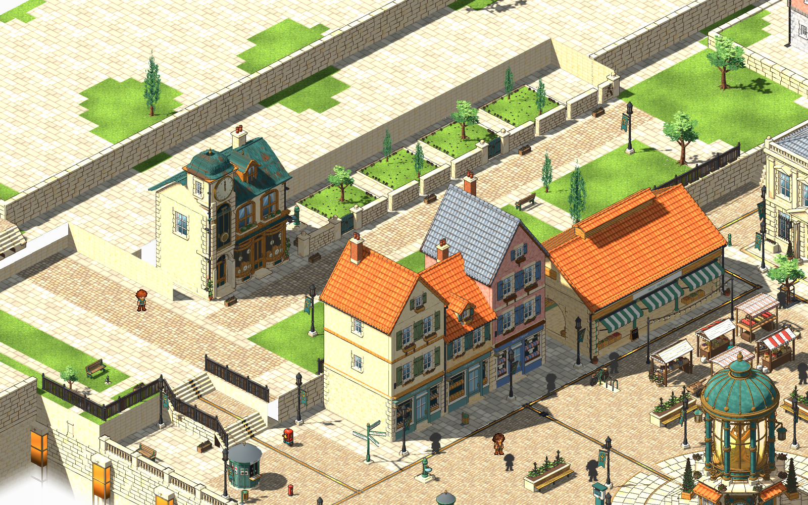
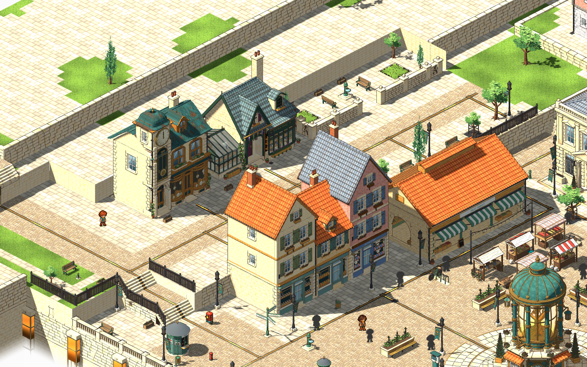
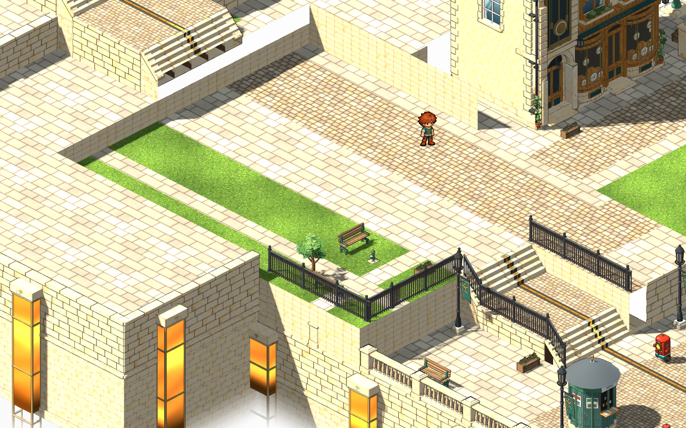
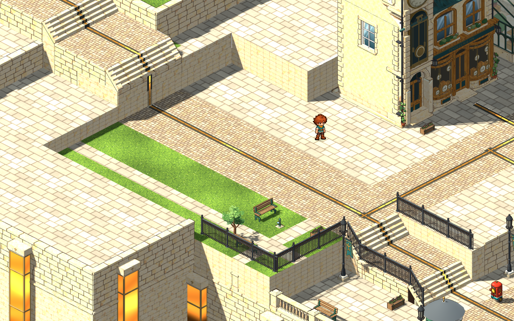
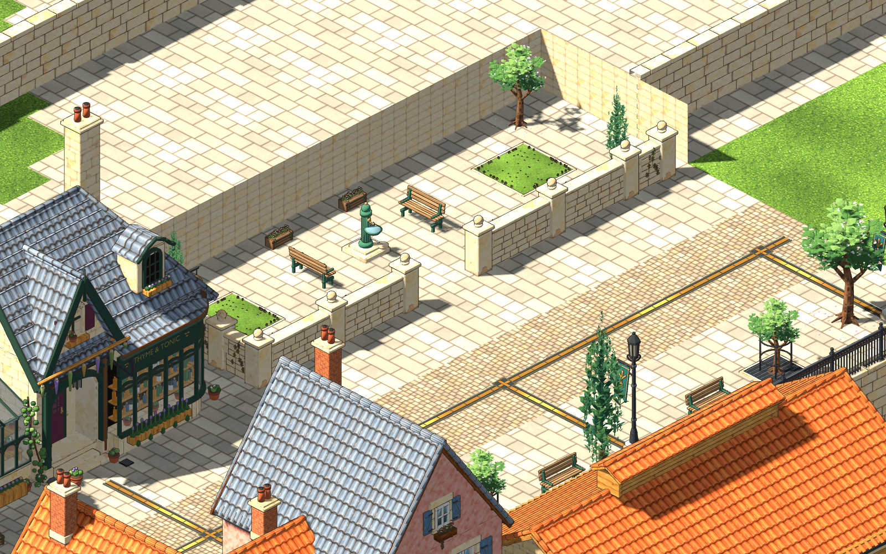
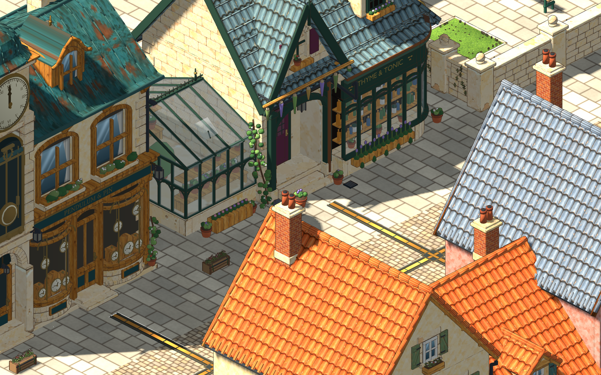
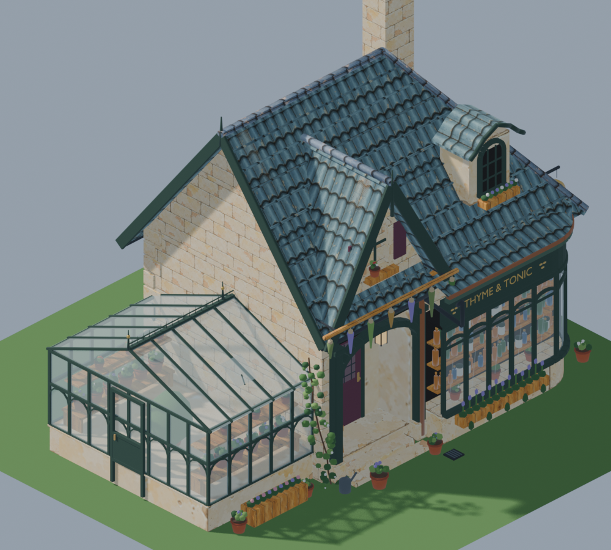
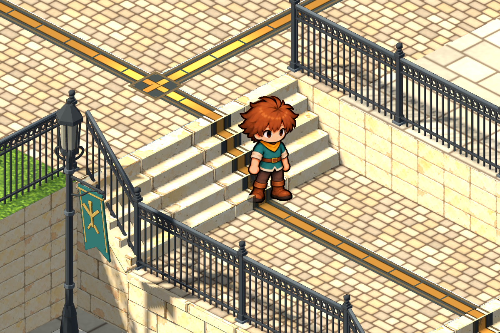
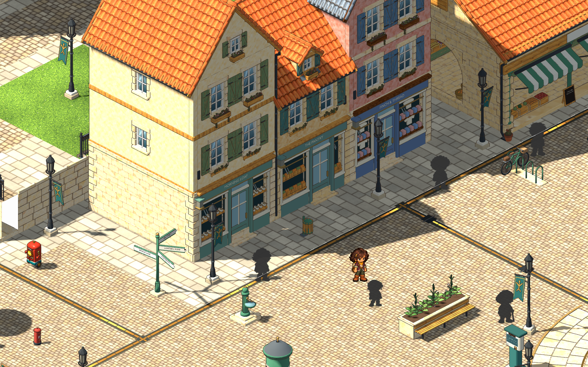
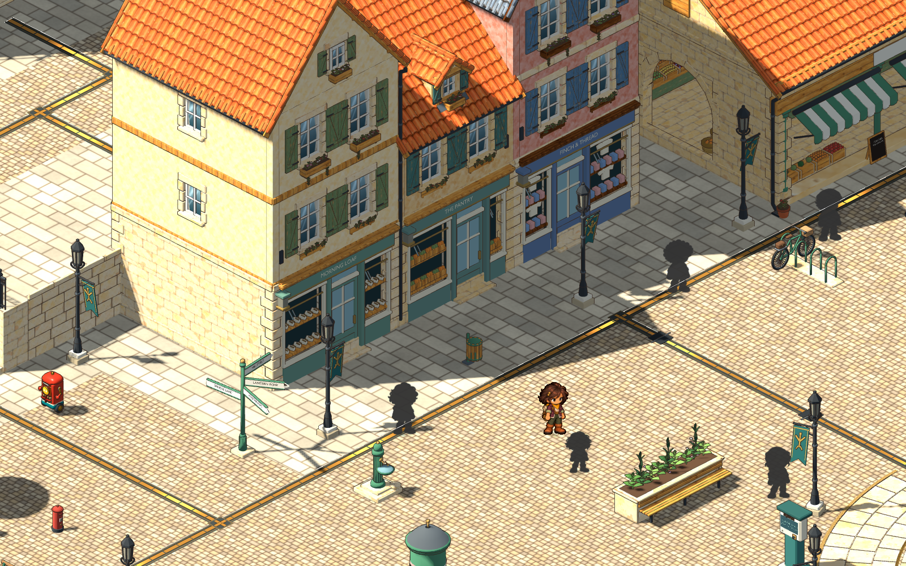

# Spindle Walk terrace, Thyme & Tonic, stairs and the shop row — 2026-11-05

The user asked for the square's upper terrace to be rearranged and repaved, with the power grid running through it, the floating walls and missing textures fixed, the apothecary from the concept built beside the clockmaker, the shadow trouble near the stairs fixed, and the three market shop-houses set one tile back so the robots stop wandering behind them. Records: [square-terrace/v1](../../art/source/world/square-terrace/v1/README.md).

## Terrace

- **One paving scheme.** Ground v8 re-cuts the terrace floor in place, so the walkable outline is exactly the old one: limestone flags, a cobbled walk from the lane steps to the top of Spindle Steps, and a cobbled spine down the promenade. The ragged lawn strips along the outer edge are paved. The small park at the arrival keeps its lawn.
- **Power grid.** The conduit used to stop at the lane steps and start again at the top of Spindle Steps. It now runs continuously: down the lane steps, up the face of the new step base, along the landing, then up the spine, with feeds to the clockmaker's and apothecary's doors and to each walk lamp. It uses the same channel, glass and service plates as the rest of the city, and the glass is flagged `power_grid`, so it glows and dims with town power.
- **Walls.** The free-standing pit cheek behind the clockmaker and the walled lawn boxes are gone. Every wall now does a job: the rear retaining wall runs unbroken behind the shop plots, and a garden wall encloses the **physic garden** north of the apothecary. The garden's 3 m opening on the walk lines up with its fountain; benches face the fountain, and herb beds and trees sit at the ends. All garden pieces and the walk's benches and trees are layout-studio props.
- **Walk edge.** One rhythm along the outer railing: lamp, bench facing the view, tree in a grate, bench, lamp. There are four lamps at y 18 / 30 / 42 / 52.5, each fed by the conduit.
- **Missing textures.** The white panels were holes in the ground model, with the white mist behind showing through. Three voids are closed: under the lane steps (they stood on nothing), the slot north of them at x 3.5 between z 3 and z 4, and the corner pier beside the upper flight. The rear wall behind the clockmaker's plot is closed too.

## Thyme & Tonic

An original model (`haverlund-apothecary` v2) after the [concept](../../art/source/world/spindle-strip/v1/apothecary-concept.png). It has a limestone body and a steep green slate roof with a hipped end. The front cross gable carries green bargeboards and a herb drying pole hung with bundles. There's an arched dormer under a curved hood and a tall stone chimney. The bowed glazed shopfront has arched lights, shelves of bottles and jars, a THYME & TONIC fascia and a lavender window box. The recessed porch has a green arched frame, a pendant lantern and a hinged plum door with leaded glazing. The herb glasshouse wing has iron cresting, finials and benches of pots. A mortar-and-pestle sign hangs on a scrolled bracket. The rear has a service door, a water butt and crates. It's 38k triangles. The door (`door_leaf_apothecary`) opens on approach. Lamp glass is separate from the clear glazing, and the window light follows town power.

It stands at (12.55, 30.4) facing the walk, front aligned with Pendulum & Pin. Its door cell (16, 30) enters the existing `shop-apothecary` room, and leaving the room returns to that door. The room is still the empty cutaway shell; furnishing it is the next interior job.

## Stairs: feet, contact shadows and the sun

A probe slid the camera along its view axis and sideways by whole pixels, with the sun shadow on and off. Sun shadows were stable: 1.2% and 0.44% of shadow-edge pixels changed, which is resampling noise. The real fault was the walking surface. The square's Blender flights cut each level into **five 0.2 m steps**, but the feet recipe assumed four. Mid-flight the feet, and the contact shadow 1.7 cm under them, sank up to 10 cm into the next tread, clipping in and out on every step. `interior.stair_steps: 5` now drives the recipe. Contact shadows also rest on the highest tread under them (`WalkingSurface.contact_lift`) for the player, residents and passers-by. The lane, at four steps, is unchanged.

## Shop row

The bakery, The Pantry and Finch & Thread stood about 0.45 m off the terrace wall. Walkable cells in that gap let routed robots pass behind them. All three moved one cell back (x 31.4 → 30.4), with their door links, inspections and window lamps. The cells behind them are now inside their collision; a test checks this.

## Saves and editing

Area v9 bumps the layout epoch to 9. Older studio edits are archived, not replayed over the new ground (the exported layout had none). Feet saved on cells that changed recover at the arrival, and programs and memory stay. Ground v7, area v8 (via git), apothecary v1 and every earlier master are untouched.

## Checks

- `scripts/world-art.sh build` for `haverlund-square-ground` (v8) and `haverlund-apothecary` (v2), followed by an editor import.
- `scripts/test.sh full`: **46 of 46 passed**. `test_square_renewal` now checks the apothecary door both ways, the physic garden's reachability and that no path runs behind the three shops. `test_square_layout` checks that the plots and garden are high ground and nothing past the rear wall is.
- Reviewed at gameplay scale with `tools/area_shot.gd`, plus temporary probes (depth-free hole render, camera-ray pick, shadow-edge stability, the player mid-flight).

Not checked: a human play-through, the apothecary at night with the town's own clock, and the robot routes over a long run. Not committed.
