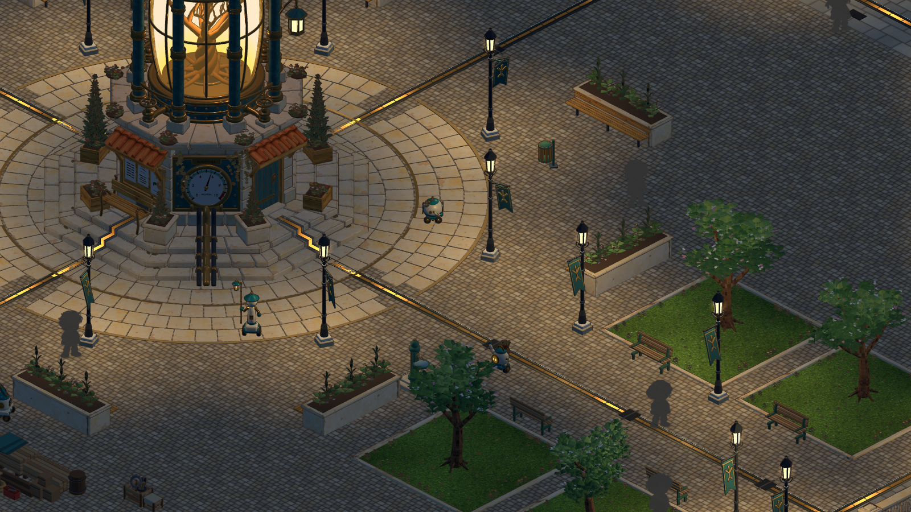
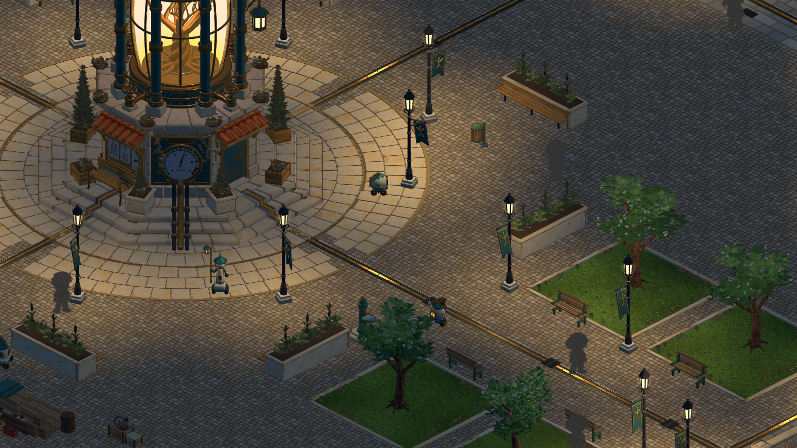
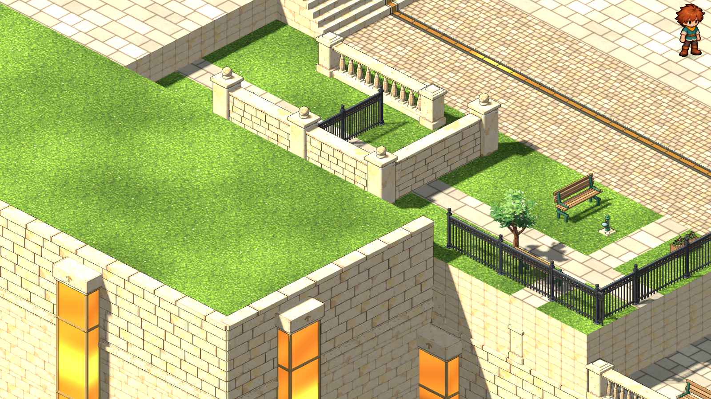
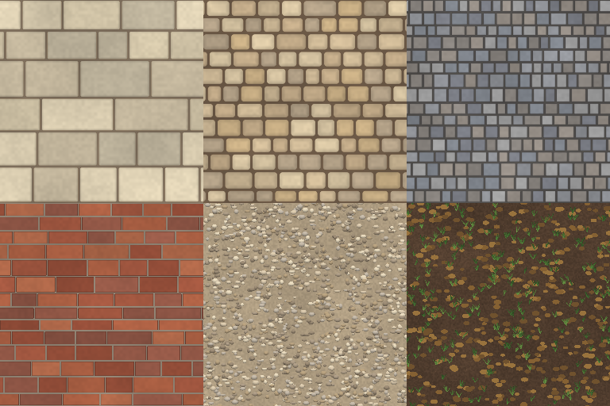
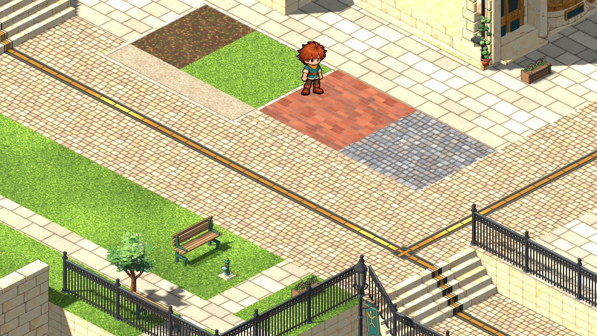

# Build mode with real freedom: four slices — 2026-11-06

The user approved the [proposal](../../docs/concept/v0.8/build-mode-freedom.md): walls on cell edges, designer first (the player gets their own home, then a small area, later in the story), conduit re-routing nice but not needed, order 1 → 2 → 3 → 4. All four are built as first versions. The fixed frame is the ground's levels and walls, the stairs and the loading entrances; everything else in the square can now be designed. Details: [BUILD](../BUILD.md#freedom-in-the-layout-2026-11-06).

## 1. Authored scenery moves

The square's layout now covers the whole square. Stairs and walls are refused everywhere. `interior.layout.scenery` lists 25 asset types, which gives 119 movable placements: 39 lamp standards, benches, trees, stalls, the kiosk, bins, bollards, planters, post boxes and more. The Move tool chooses, lifts, sets down and turns them, with undo and saves. Each move takes along the furniture block at the placement's position (its collision), the fixture lamps mapped to it (position, the cell it is worked from, light) and its ground height. A lamp keeps its id and program. Scenery is never deleted.

## 2. Walls, Sims-style

The **Walls** tab offers three styles: garden wall, balustrade and iron railing.

- **Drawing:** drag from a cell corner along the grid, or click two corners.
- **Assembly:** the run is built from the town's existing wall kit. It uses the fewest whole bays, stretched slightly to fit, with one pier or post at each joint, end, corner and T-junction. Where styles meet, the heavier style's pier is used.
- **Rules:** a run must stay on one level, off the stairs and entrances, and clear of buildings, scenery, lamps, trees and the spawn.
- **Walking:** a run blocks the edges it runs along, so routes go around it. Delete takes a run down.

Not built: height variants (the kit has one height per style), hedges, and gates set into a run.

## 3. Town ground

Land → **Town** has seven paints. The square's own flags and cobbles are copied unchanged. Setts, brick, gravel and the planting bed are new, painted by the same deterministic routines as the lane's paving, and the lawn is the existing grass picture. Paving is cut straight on the half-cell grid. Lawn, bed and gravel get a limestone kerb with a dark lip where they meet paving, including the square's own Blender surface around a painted patch. No adopted Blender source was re-baked: the prior texture catalog is recorded as the compatible ancestor.

## 4. Code

In the studio, programs in the square can read, turn and move. `world.doodads` now includes the town's scenery, and `doodad.lamps` names the lamp a standard carries. `doodad.move_to(x, y)` and `doodad.face(...)` are checked by `CodeBuild` under exactly the builder's rules, and a whole run is accepted or refused together. A real Python run in the sandbox moved a lamp standard.

Not built: on/off capabilities for simple objects, such as a fountain that flows or a gate that opens. Each needs a `mechanism` pivot or a `state_glow` material authored into its model, which is an art pass per object. The notebook preview does not yet ghost a moved piece of scenery.

## Checks

- `scripts/test.sh full`: 46 of 46 passed.
  - `test_square_layout` (48 checks) covers scenery moves with lamps and collision, wall rules, piece counts and edge blocking, town paints, and code moves, including real Python.
  - `test_layout_flow` (36 checks) drives the mouse: choose, lift and drop a lamp standard, then undo; drag a wall, delete it, undo.
  - `test_lane` and `test_pipeline_handoff` were updated for the parapet and the catalog ancestor (the handoff check now ignores the `ground` flag on both sides).
- `scripts/art.sh` built the town pictures. The run then stopped at the portrait step, which still references dialogue concept images removed in the 2026-11-05 purge. That break predates this work. The town pictures' import settings were applied with the library's own `configure` step.
- Renders at gameplay zoom for each slice (above).

Not checked: a human session in the studio, and the build HUD's look with the new Walls and Town tabs. Not committed.
