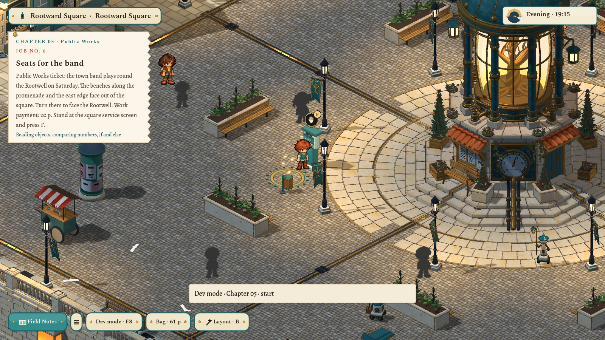
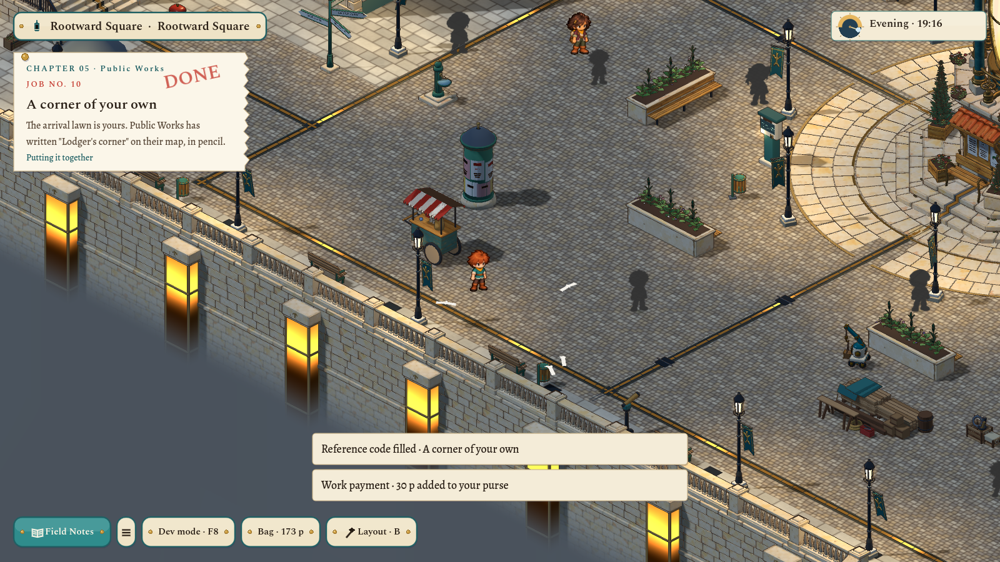
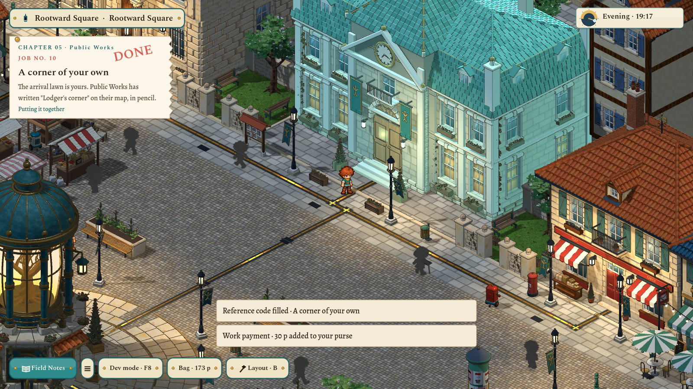
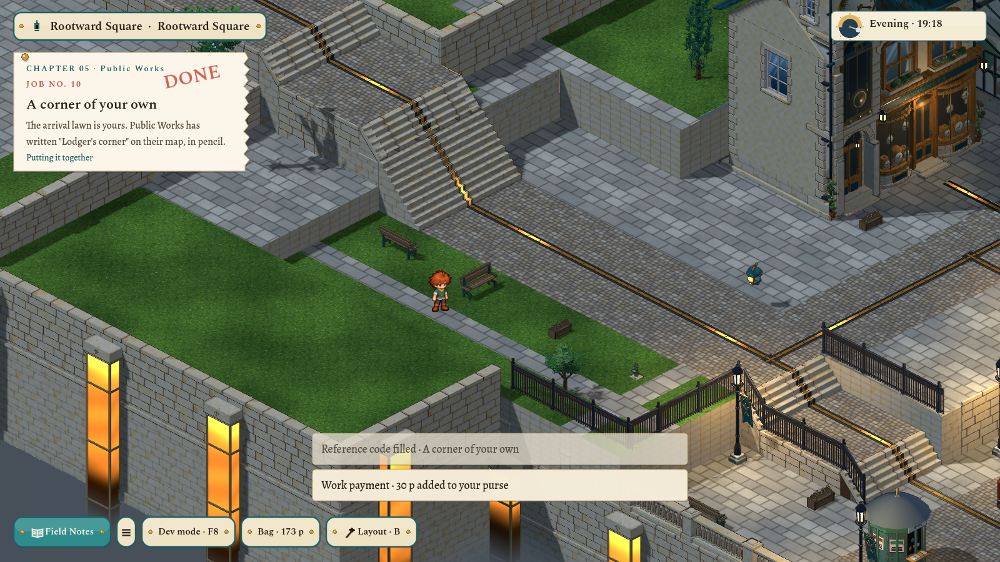

# Chapter 05 · Public Works: five quests about changing the town — 2026-11-06

The user asked for up to five new quests that continue the learning line, built around assets and ways to change the game. After *After the light*, the lodger takes on Public Works tickets in Rootward Square. Each ticket rearranges real square furniture with Python, under exactly the rules the layout studio's mouse follows, and the result stays in the town as layout edits. Design notes: [quests](../../docs/concept/v0.7/08-quests.md#chapter-05--public-works-2026-11-06).

## The ladder

The lane ended on `if`/`else` with a Boolean. These jobs continue from there:

| No. | Quest | New idea | What changes in the town | Pay |
|---|---|---|---|---|
| 6 | Seats for the band | Reading objects (`world.doodads`, `kind`, `at`), number comparison, `elif` | Seven promenade and east-edge benches turn to face the Rootwell. | 20 p |
| 7 | Room on the walk | `range` and arithmetic (`21 + 6 * i`) | Spindle Walk's four benches are spaced six metres apart. | 16 p |
| 8 | Two parks, one plan | A function with parameters, called twice | Four delivered planters flank the two pocket-park trees. | 22 p |
| 9 | Market day | Building a list with `append`, `len`, `in` on text | The three west market stalls are evenly spaced. | 24 p |
| 10 | A corner of your own | Putting it together; free design | At least three garden pieces on the arrival lawn, arranged however the player likes. | 30 p |

Code abilities are earned here, not granted. *Seats for the band* teaches `read` and `turn`, and *Room on the walk* teaches `move`, the new `doodad.move_to`. Every starter runs, prints something useful, and leaves its job open. Hints step from "what does this line do" to the fix. Characters stay out of the syntax, and each job ends on something happening in the town ([dialogue rules](../../docs/concept/v0.7/07-dialogue.md)).

## Engine changes

- **Cross-room gating.** A quest can name `after`: jobs finished elsewhere on the journey. The session and the jobs list pass the journey's finished jobs into `Quests.available`, `current`, `capabilities` and `newly_completed`.
- **Arrangement goals.** `doodads_face_point`, `doodads_at` (with an optional facing and tolerance), `doodads_row` and `doodads_in_rect` work over placed props and movable scenery alike, and are validated against known ids.
- **Residents keep their stops.** A bench or stall that someone already rests at or trades at may be turned or nudged while that stop stays beside it. Crowding a stop that had room is still refused.
- **Content.** Four `delivery-planter` props were added beside the kiosk for job 8. There are chapter 05 tickets, payments, dev checkpoints (`works-start`, `works-end`, which may now name completed jobs per room) and dev reference solutions.

Fitting the jobs to the real square changed two ideas from my first plan. The pocket-park benches sit on residents' routes, so job 8 moves delivered planters instead. Two of the five stalls are targets of residents' trading errands, so job 9 respaces the three west stalls rather than gathering all five.

## Checks

- `scripts/test.sh full`: 46 of 46 passed, including the dev-mode play-through check (`test_development`, 96 checks).
- `test_area` (57 checks) covers each job in order:
  - The reference solution runs as real WASI Python, passes `CodeBuild` under the player policy, is kept, and meets the goal.
  - Each unchanged starter runs but leaves its job open.
  - The jobs open only after the evening job.
  - Abilities arrive with the right tickets.
- `test_development` jumps to Chapter 05 and finishes all five jobs in the running game through the real preview and Apply, with the edits kept and wages paid.
- Screenshots of the ticket and each result were taken at 1600×900.

Not checked: a human playing the five jobs from the start of the journey; whether the lessons read well on the slate; and night-time lighting of the moved pieces. The notebook preview does not ghost moved scenery before Apply. Not committed.
