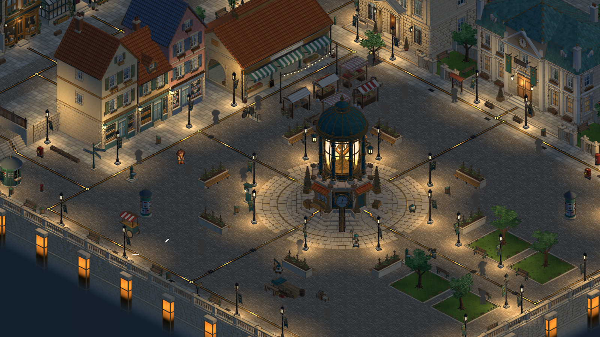
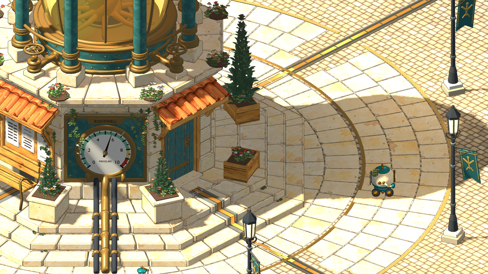
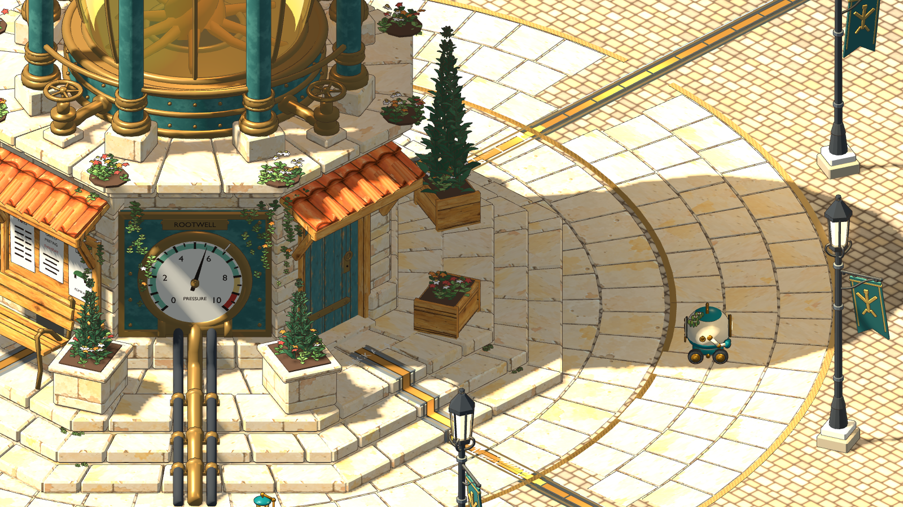
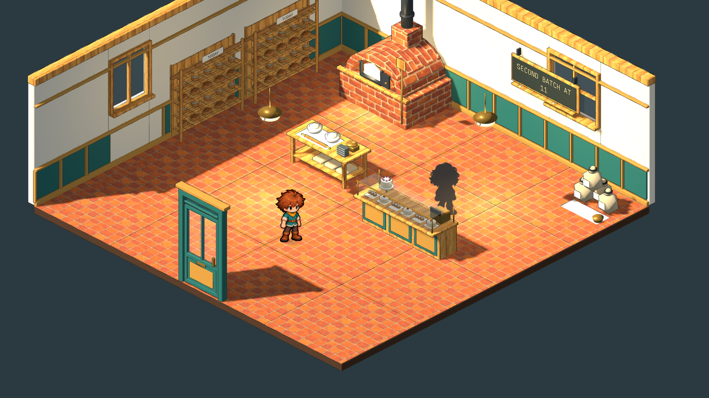
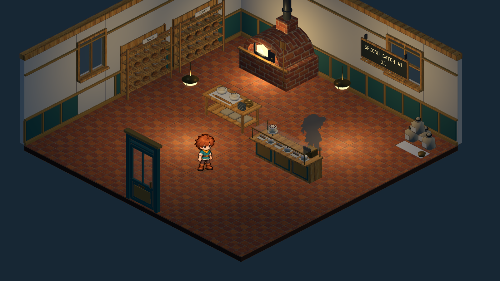
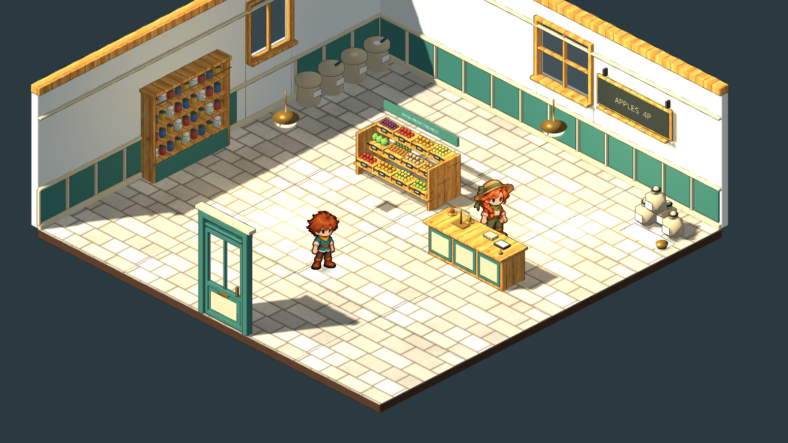
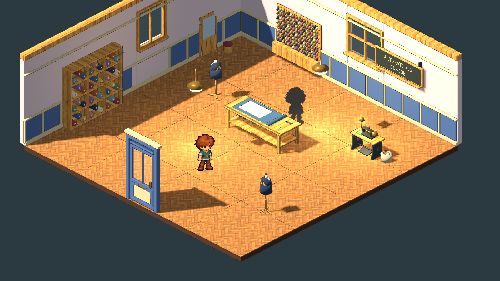
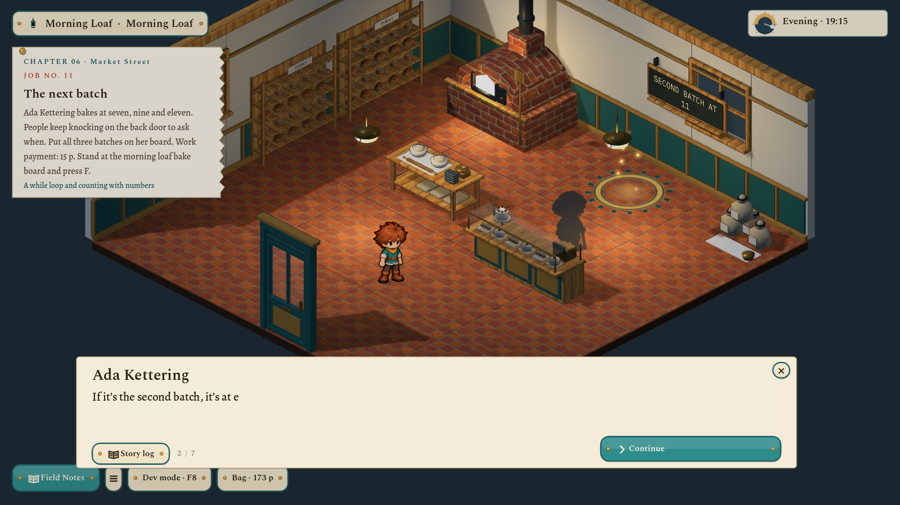

# Night lighting, the Rootwell, three shop interiors and Market Street — 2026-11-06

The user asked for consistent night lighting, the Rootwell's texture faults fixed, the three market shops (bakery, grocer, tailor) made into real interiors with their own doors and custom furniture, more story with the dialogue checked two or three times for consistency, and new programming ideas. Records: [shop-interiors/v1](../../art/source/world/shop-interiors/v1/), [rootwell-texture-pass/v1](../../art/source/world/rootwell-texture-pass/v1/even_uvs.py).

## Night lighting

The Compatibility renderer draws at most 32 lights a frame by default, and the square alone has 70 lamps. Lamps past the nearest 32 kept their glowing glass but lit nothing, which is why light appeared to switch on as the player approached. Two changes fix it:

- Every lamp now has a soft, unlit **light pool** on the ground under it (`ClearingView._light_pools`, an additive radial card on the unlit layer). It shows whenever the lamp is on. Outdoors it fades with daylight; indoors it glows softly at any hour. It casts no shadows and costs one quad per lamp. Pools follow lamps that build mode moves.
- `rendering/limits/opengl/max_renderable_lights` is raised to 64, so more of the near lamps also light their surroundings for real.

## The Rootwell

The beacon's stone ranged from 0.15 to 3.7 UV units per metre, and the plaza's from 0.16 to 0.6. Some stones showed a single blotch stretched over six metres while their neighbours were crowded. `rootwell-beacon` v3 and `rootwell-plaza` v3 re-project the UVs:

- **Walls:** the square's even 1.9 m ashlar.
- **Flags and treads:** each upward face takes the inside of one painted block, so no painted joint crosses a modelled one.
- **Verdigris metal:** an even 1.6 m.

Geometry and materials are untouched, and v2 of both is retained.

## Morning Loaf, The Pantry, Finch & Thread

The rooms were empty plank shells with a borrowed barn door standing in the middle of the floor. There are now 19 original models (`art/source/world/shop-interiors/v1/author.py`), each registered on its own so the studio and later rooms can reuse them:

- **Shells:** each shop has its own floor (terracotta tile, the square's limestone flags, herringbone oak), plaster, wainscot in the shopfront's colour, side and rear windows, and a glazed door matching the shopfront it belongs to (teal-green, sage, slate blue), hinged on `door_leaf_<shop>`.
- **Morning Loaf:** a domed brick oven with a flue and an arched iron door. Its fire is lamp glass, bound as the fixture lamp `oven-fire`, so it glows at night and a program can switch it. Also two bread racks of tin loaves, rounds and baguettes; a glass serving counter with buns, tarts, a till and a cake stand; a proving table; and flour sacks.
- **The Pantry:** a three-tier produce stand (apples, oranges, lemons, greens, carrots, plums, each crate with a slate tag), a dresser of jars and tins, a row of open sacks, and a counter with a brass beam scale, paper bags and a bell.
- **Finch & Thread:** pigeonholes of cloth bolts, a thread wall of 128 spools, a cutting table with a yard rule and a pinned pattern, two dress forms wearing a half-made coat, a treadle sewing machine (its work lamp is the switchable `sewing-lamp`) and a cheval mirror.
- **Shared:** `shop-chalk-board`, a framed slate with a `SignFace` anchor, which the game letters live.

Each room (document v3) also has brass pendants (the lamp ids are unchanged, so saved programs still work), four inspections, a chalk board that is a display with a commission note, and a shopkeeper with a small working round between counter and oven, stand or table.

- **Shopkeepers:** Tessa minds The Pantry in her own painted sprite. Ada Kettering and Gret Finch are new characters and appear as the town's placeholder silhouettes. Their sprites and portraits need painting through the character pipeline. Until then they speak in scenes with their names only.

## Story

Two chapters were added and the existing dialogue was read three times: once for facts, once for everything the player reads in order (tickets, summaries, done lines, notes), once for voice with the names hidden.

- **Chapter 05 · Public Works** now has a person: **Mira**, the town's map-maker. She hands out the five square tickets at the service screen. The benches now take instructions because the conduits went in. She returns after the band's benches and at the end, when she pencils "Lodger's corner" on her map. Then she reads the Rootwell's dial: four last month, three and a half now, written down every Thursday. That plants the next mystery without explaining it.
- **Chapter 06 · Market Street** has one job in each shop. Each starts with its own scene, and each pays when the board is right:

| No. | Job | Who | New programming idea | The board shows |
|---|---|---|---|---|
| 11 | The next batch | Ada Kettering, baker, 41 years at the same oven | `while`, counting with numbers, `str()` | BATCH AT 7 / 9 / 11 |
| 12 | Today's prices | Tessa, minding her cousin Teo Vasko's shop | Dictionaries: look up and change a value | APPLES 4P / LEMONS 3P / PLUMS 5P |
| 13 | Ready for collection | Gret Finch, tailor | Functions that `return`, text methods (`.upper()`) | BRAUM READY / IONA READY / MIRA READY |

- **Fixes to existing story:**
  - Hotaru called Braum "Bram" on the lane, and the Rootwell "the beacon".
  - Nell explained `if`/`else` line by line in the evening scene. Characters bring problems and the notebook brings syntax ([dialogue rules](../../docs/concept/v0.7/07-dialogue.md)), so she now asks the player to read the card the way the lamp does.
  - The evening ended on a moral. It now ends on the two lamps coming on together, and Nell sends the lodger to Mira.
  - Scenes outside the workshop had "The workshop" as their narrator label.
  - Supporting text: the square's notices now record the Rootwell's reading, the poster column advertises the band for Saturday (as Mira's ticket says), the hall's job desk points to Mira, and the own-corner done line no longer gives away her scene.

### What the shops can carry next

The rooms already hold the hooks:

- **The oven fire:** a lamp to schedule by the hour (needs `world.time.hour`).
- **The proving bowls:** a pencil line above the dough, for comparisons and thresholds.
- **The beam scale:** for functions that compute a price.
- **The thread wall:** one row has two blues swapped, which sets up a sorting job.
- **Gret's order book:** fourteen finished and two collected, which sets up filtering a list.
- **Teo's prices:** they change every day, which suits keeping data in `world.memory`.

## Engine and checks

- **Engine:**
  - A `display_lines` goal (`core/quests.gd`).
  - Quests can carry their own notebook `guide` panel.
  - Story speakers `mira`, `tessa`, `ada`, `gret` and `note` exist (named, without portraits), and the scene limit is raised to 40.
  - Development checkpoints `market-start` and `market-end` can name finished jobs per room.
- **Tests:**
  - `scripts/test.sh full`: 46 of 46 passed.
  - `test_area` (75 checks): each shop job's reference runs as real WASI Python and only the finished routine writes the shopkeeper's lines. Each board can be written from where the job stands you.
  - `test_development` (107 checks): Chapter 06 opens at Morning Loaf, the note is read and Ada's board shows three batches after the real preview and Apply.
  - `test_square_renewal`: now expects the furnished shops (and that the apothecary is still empty).
  - `test_city_cycle`: confirms every lamp-glass model, the oven and sewing lamp included, is connected.

Not checked: a human playing Chapters 05 and 06 from the start; the scenes at other window sizes; portraits and sprites for Ada and Gret (not made). Not committed.
