# Texture pass on the square and fog for Spindle Lane — 2026-11-06

The user circled texture problems in five night screenshots: the square's front wall, Spindle Steps, the high ground behind the terrace, the north end of the walk, and the lane's walls, lower town and north gate. They also asked for fog around the area outside the workshop and a more natural look there. Records: [square-texture-pass/v1](../../art/source/world/square-texture-pass/v1/README.md).

## Below the walls at night

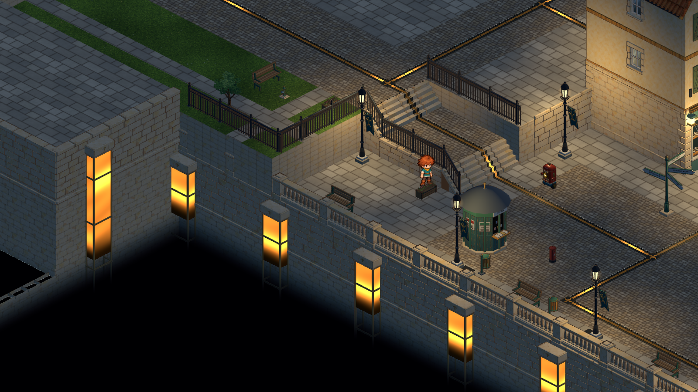
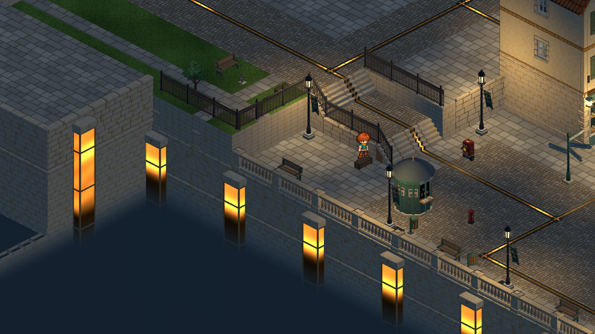

- The mist was near-black at night, so the walls dropped into a void. It is now a moonlit blue haze (`1d2b3b`) that keeps its brightness as it deepens.
- The power columns cut their amber glass off at the mist line, leaving empty bronze frames hanging in the dark. The glass, stone and conduits now stay whole below the line, just unlit, and the mist covers them.

## Spindle Steps

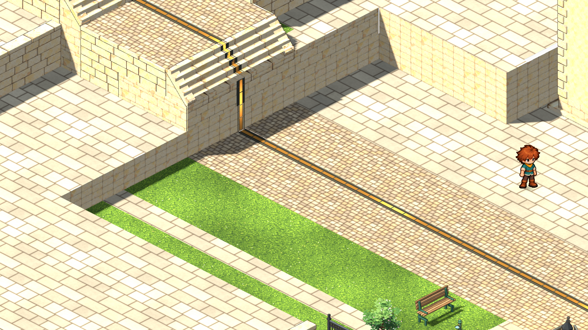
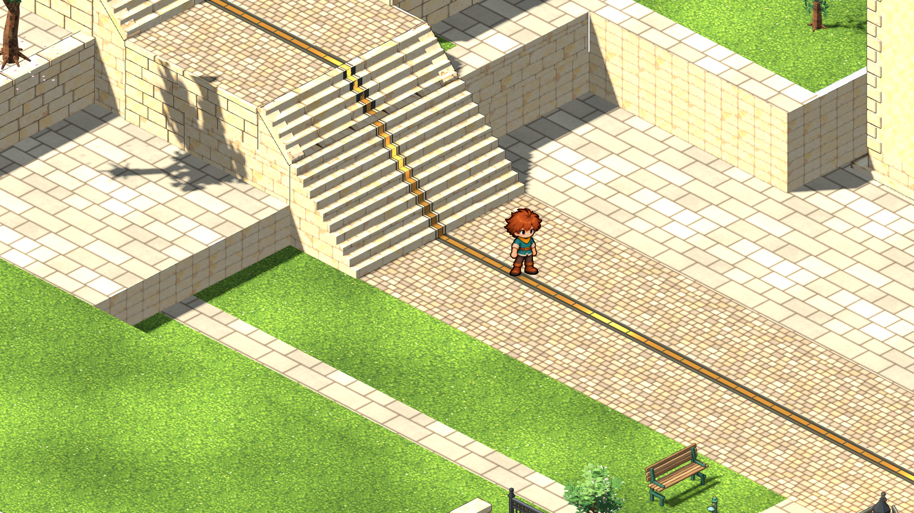

The flight to the lane ended on a 2 m block above the terrace, with the conduit running straight down the block's face. Ground v9 adds ten 0.2 m steps down to the terrace floor, and the conduit follows the treads. The two new step cells are blocked. Walking west onto the foot of the flight now climbs to the lane through a second link (`uphill-steps`), as walking west past the spawn always has.

## High ground, the walk's north end

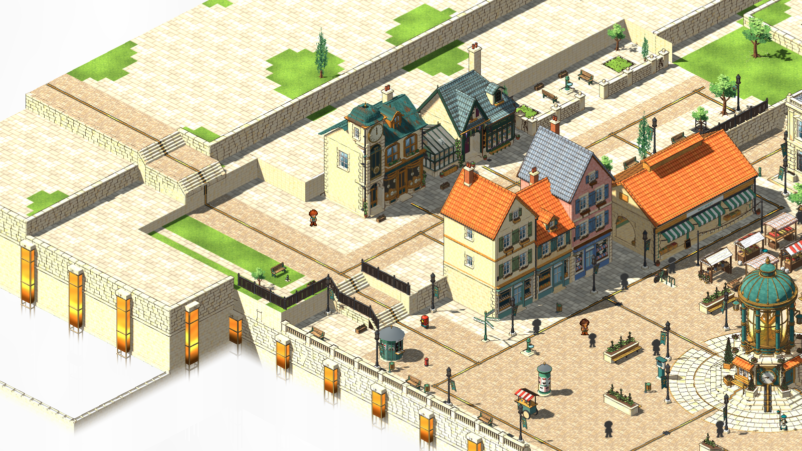
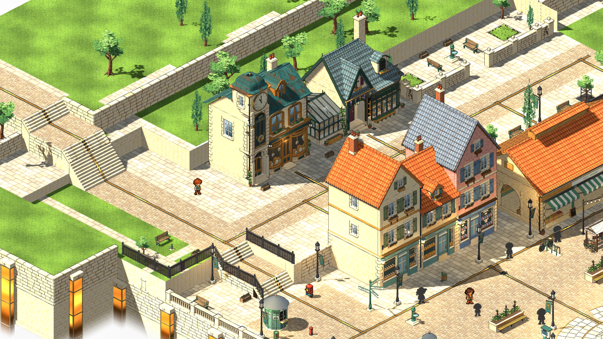
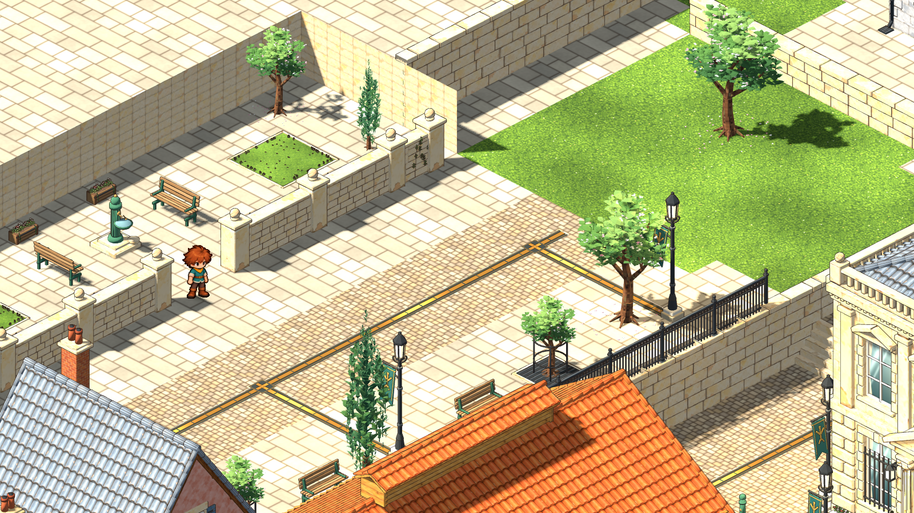
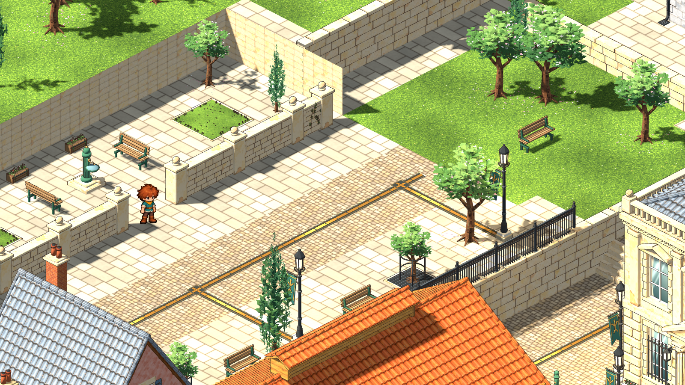

- Behind the rear wall, west of the steps and above the arrival lawn, the high ground was empty limestone with blocky grass patches, and the corner beside the clockmaker read as a free-standing block. Those flags are now lawn, with cypresses and fruit trees along the top of the wall and more trees further back. The square's terraces read as sitting below the upper town's gardens.
- The empty lawn at the north end of the walk has two trees, a cypress and a bench facing the view. These are layout props, so build mode can move them.

## Spindle Lane

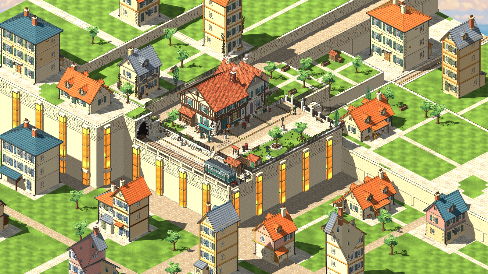
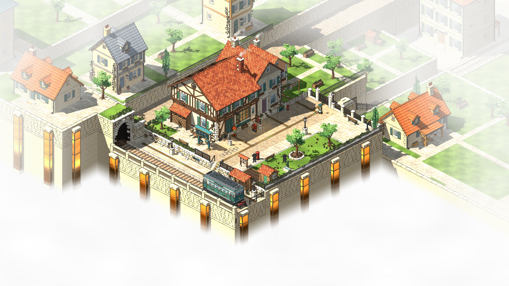
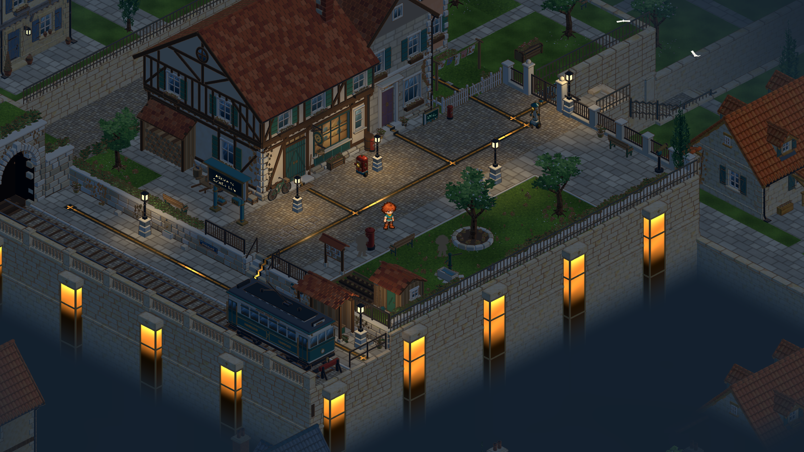

- The lane now has the square's mist (`fade_top` -2.5, solid by about -5.6), so the lower town 8 m below its walls is cloud. The ten houses and eight trees down there showed only as roofs poking through the mist and jammed against the walls (the X'd ones), so they were removed, along with their window lights.
- A new edge haze (`depth_fog.edge`, starting 1 m past the area and reaching 0.92 by 18 m) thins the gridded gardens and house plots around the lane, so the lane stands in a misty hilltop town rather than on a game board.
- Beyond the north gate, the town steps run away from the camera, so only their east handrail showed, as a zig-zag rail over the lawn. Lane surround v2 replaces it with a stepped stone parapet with coping.

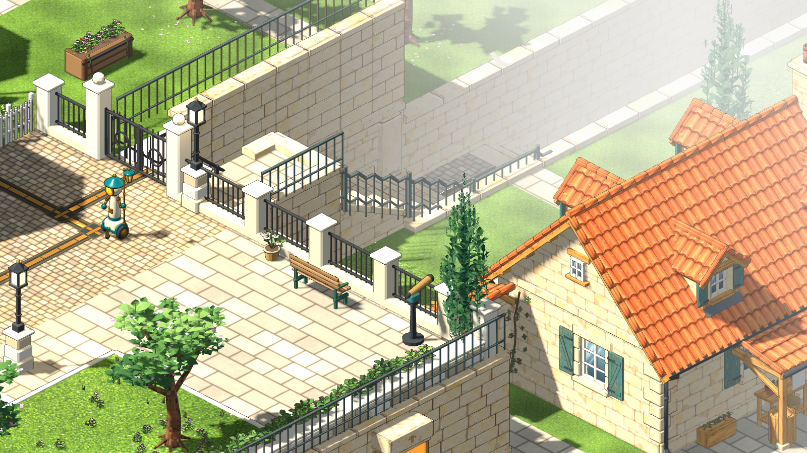
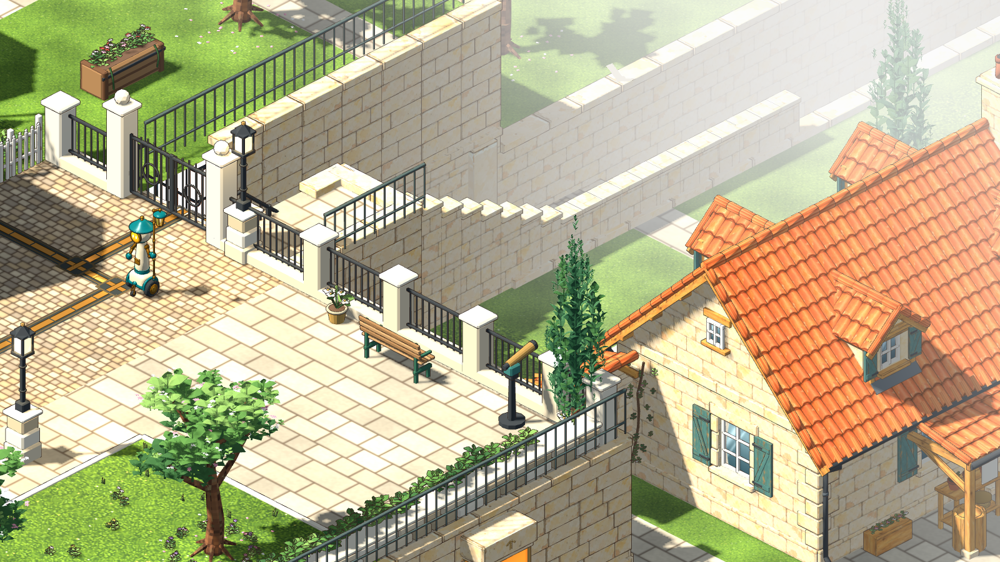

## Checks

- `scripts/world-art.sh build` for `haverlund-square-ground` (v9) and `haverlund-lane-surround` (v2), followed by an editor import.
- `scripts/test.sh full`: 46 of 46 passed. After the new checks, the quick tier passed 32 of 32, and `test_lane` (171 checks) and `test_square_layout` (30 checks) passed. New checks: the foot of the flight climbs to the lane, and the flight is not floor; the lane has mist and edge haze.
- Renders of each circled place were checked by day and night at gameplay zoom.

Not checked: a human play-through, and frame rate with the lane's fog on a slower GPU (the overlay is one full-screen pass, as in the square). The gridded upper gardens around the lane are only softened by the haze, not re-authored. Not committed.
