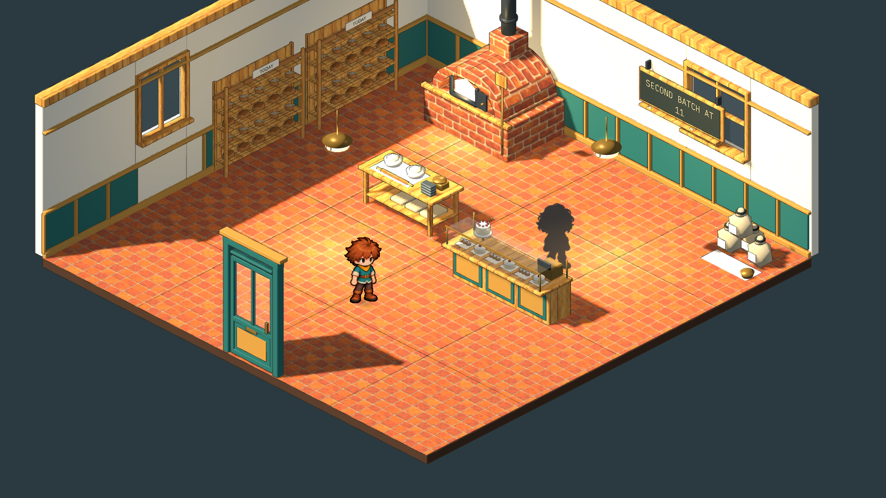
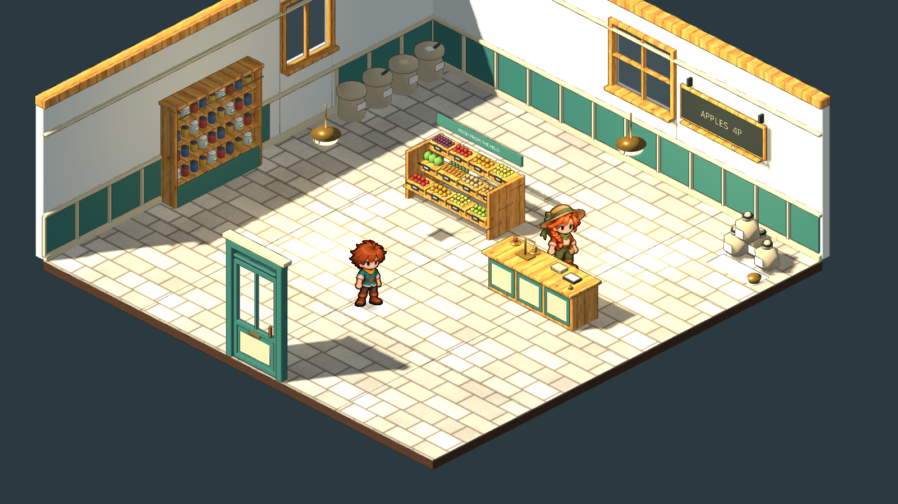
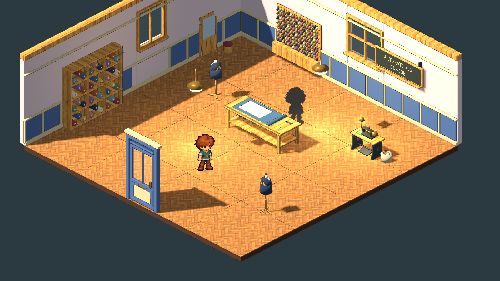
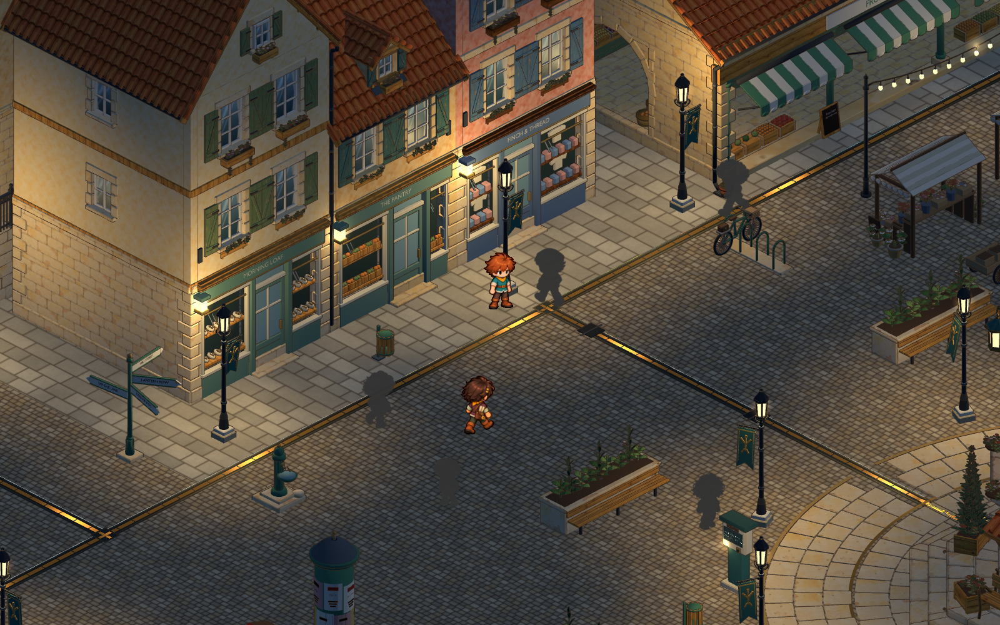

# Market Street's three shops, furnished properly — 2026-11-12

The user found the bakery, the food shop and the tailor "very very bare bones". They asked for:

- detailed, lavish interiors with new furniture and props, each shop unique;
- the windows outside spruced up with features of their own;
- nothing of low quality.

The 2026-11-06 rooms had six to nine simple pieces each: the bakery oven was 772 triangles, and the storefronts were three near-identical teal-green fronts with a shelf of the same shape of wares. This pass rebuilds all three with the clockmaker's room as the bar to beat. The source pack is [shop-interiors/v2](../../art/source/world/shop-interiors/v2/README.md).

| Before | After |
|---|---|
|  |  |
|  |  |
|  |  |
|  |  |

All the "after" pictures are the running game at its normal camera, taken by `tools/reviews/market_shops_review.gd`.

## What was made

There are 48 masters for the rooms: 31 new models and 17 new versions of existing ids, with every earlier version kept. Each room is laid out as room document version 4; version 3 is kept in `content/areas/archive/`.

- **Morning Loaf** (20 placements, 5 lights). A baker's shop in oxblood and white tile:
  - Ada's brick beehive oven, with a copper hood, a stovepipe into the chimney breast, a log store, peels, a gauge and a brass KETTERING 1885 plate. Its fire is still the `oven-fire` fixture.
  - A wall of tilted bread baskets under a gilt OUR DAILY BREAD header, with a bread slicer.
  - A marble counter with a curved-glass patisserie case, a brass till and a domed cake.
  - A three-tier cake table topped by a wedding cake, a baker's bench of dough and cane proving baskets, a glazed proving cabinet and a green enamel dough mixer.
  - A wheeled cooling rack, flour sacks on a pallet, a dresser of blue-and-white china and copper moulds, a pretzel tree by the door and an étagère of jams and biscuits.
  - Bentwood café tables, a plate rail, gingham café curtains, a station clock, an oxblood back door to the bakehouse and green enamel pendants.
- **The Pantry** (18 placements, 3 lights). Teo Vasko's provisions shop as a market hall in one room:
  - His barrow, brought in off the street, under painted sign letters (with older letters showing through).
  - A double-sided produce island and a provisions counter with a cheese case, a brass beam scale and a red coffee mill.
  - A bin wall of dry goods by weight and a dresser of preserves with a library ladder.
  - Barrels, open sacks, a dairy cupboard with churns, a stepped stand of flower buckets, a basket table, a platform scale, a pallet of pumpkins and a crate stack with a sack truck.
  - Green-boarded walls under sage sprig paper, strings of onions and garlic, and bottle-green glass pendants.
- **Finch & Thread** (19 placements, 4 lights). Gret Finch's atelier in navy, rose stripe and velvet:
  - A curtained fitting booth and a three-way mirror on a dais.
  - Three dress forms: Braum's tacked coat, a velvet gown and a tweed waistcoat.
  - Under the order board, a rail of the finished orders, each in a paper cover with its owner's ticket.
  - The thread wall, still with its two swapped blues, and a bolt cabinet with a ladder.
  - A glass-topped haberdashery counter of buttons and ribbons, the treadle machine (still the `sewing-lamp` fixture), a pressing station, a velvet settee, a knotted rug and brass chandeliers.

### The storefronts

`haverlund-bakery`, `-greengrocer` and `-tailor` each move to v3 by a deliberate edit of the v2 master; the upper storeys, roof, door hinge and wall lantern are untouched.

- **Every front:**
  - The old shelf of wares is gone, and each window is now a dressed display box 0.7 m deep behind real glass, with gold-leaf lettering on the pane.
  - The joinery is painted in the shop's own colour: oxblood, bottle green or navy. The bakery and the Pantry had been almost the same green.
- **Morning Loaf:**
  - a cream and oxblood awning;
  - a bracket sign with a gilt pretzel;
  - geranium window boxes;
  - a stepped window of a wedding cake, tarts and cupcakes under a pretzel garland, and a basket of baguettes.
- **The Pantry:**
  - a green and cream awning;
  - a sloping ledge of crates under the big window;
  - hanging baskets and a bucket of sunflowers by the door;
  - a window of raked crates, jam jars and onion strings.
- **Finch & Thread:**
  - a scalloped navy valance with a gilt fringe;
  - a bracket sign with gilt shears;
  - topiary in navy tubs;
  - velvet-backed windows with the gown, a tailcoat and a top hat.

Nothing stands more than 0.25 m in front of the wall, because the pavement cells in front of the doors are where the player walks in.

## What stays the same

- **Room ids and links:** the room ids, door links, arrival cells and spawn are unchanged.
- **Boards and keepers:** each board, its commission note and its Chapter 06 job are unchanged, and so are the keepers.
- **Lamps:** the ids a save can hold are unchanged (`shop-pendant-1` and `-2`, `oven-fire`, `sewing-lamp`). The bakery adds pendants 3 and 4, the tailor pendant 3.
- **Inspections:**
  - The rooms keep their old inspections, some moved to stand by the new furniture.
  - Each room adds three more, which plant a little story: the wedding cake is FOR THE HALL — SATURDAY, the clock runs four minutes fast "so the bread is never late", the mixer is No 2, Teo's barrow shows VASKO & CO under the paint, there are six sunflowers kept back for Mira, and the gown is for the band's singer.
- **Keepers:**
  - Ada now also checks the cooling rack.
  - Tessa tends the flower stand.
  - Gret works the haberdashery counter.
- **Ada's board:**
  - It now hangs over the bread wall.
  - Her line in the journey ("The board's up over the bread") and the room hint say so.
  - Her complaint about people knocking at the back door now has a back door to point at.
- **The oven:** the `oven-fire` stand moved one cell east, because standing where it was opened the fire's code rather than the oven's inspection (the v3 room had the same clash).
- **Retired:** `bakery-bread-rack` is `retained_previous_concept`.

## Quality and cost

- **Detail:**
  - Pieces range from 1 k to 85 k triangles. The produce island is the heaviest, at 85 k.
  - The rooms total about 0.93 M triangles with the three storefronts, and each room shows 300–350 draw calls.
  - Every room renders at the 168 fps cap at 1600 × 900 on the development machine's integrated Radeon 680M.
- **Materials:**
  - Plain colours share a palette atlas, so a piece is typically 4 to 9 materials.
  - Small details use the palette's fine materials, so they carry no ink outline.
- **Shadows:** pendants, chandeliers and the rug cast no shadow.
- **Z-fighting:**
  - `test_coplanar` holds the three storefronts to their existing allowance.
  - The same check, run on all 48 new interior pieces at a stricter 0.05 m², found layered mats, trims, sills, glass on frames and cloths on tabletops that sat 1–3 mm apart. All are now at least 4 mm apart.
  - One sliver behind the station clock's face remains (0.06 m²), out of sight.

## Checks

- **`scripts/test.sh full`:** 47 of 47 passed.
- **`tools/reviews/market_shops_review.gd`, in the running game:** 105 checks, 0 failures:
  - it walks the street at day, evening and night;
  - it enters each shop through its real door (the leaf swings);
  - it reads every inspection with F;
  - it photographs each room by day and at night;
  - it walks back out to the square.
- **A reachability pass:** every inspection, board, keeper stop and the door approach is reachable from the spawn in all three rooms.

## Not checked

- **Other window sizes:** the rooms were viewed only at 1600 × 900.
- **Placeholders:** Ada and Gret still have no painted sprites (placeholder silhouettes).
- **Publishing:**
  - `media.lock` is rewritten locally (`scripts/pack-media.sh --write`), but the packs are not published.
  - Nothing is committed.
- **Studio shelf:** the new pieces have catalog footprints but no studio shelf entries yet.
